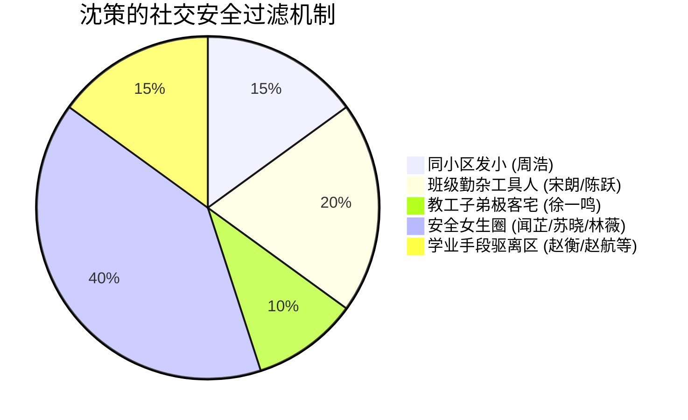

# 配角与NPC档案集（Supporting Cast & NPCs）

> **世界观基准**：方案B · 双边对称中产知识分子家庭生态。所有角色服务于现实书香知识分子环境构建、规则秩序与学业博弈。

---

## 目录索引
- [一、 核心背景家长组（知识分子中产双轨模型）](#一-核心背景家长组知识分子中产双轨模型)
  - [家庭阶层基准与小区生态](#家庭阶层基准与小区生态)
  - [1. 陆明远（女主之父）](#1-陆明远女主之父)
  - [2. 林知微（女主之母）](#2-林知微女主之母)
  - [3. 沈振邦（男主之父）](#3-沈振邦男主之父)
  - [4. 温静姝（男主之母）](#4-温静姝男主之母)
  - [两家关系图谱与中产知识分子同盟](#两家关系图谱与中产知识分子同盟)
- [二、 外部次要人物组（创新班受控社交圈）](#二-外部次要人物组创新班受控社交圈)
  - [沈策受控社交圈分类结构](#沈策受控社交圈分类结构)
  - [白名单特许男生组（工具人与发小）](#白名单特许男生组工具人与发小)
  - [普通安全同性圈与学霸组](#普通安全同性圈与学霸组)
  - [黑名单精准驱离案例（学业与日常手段）](#黑名单精准驱离案例学业与日常手段)

---

## 一、 核心背景家长组（知识分子中产双轨模型）

### 家庭阶层基准与小区生态
* **居住环境**：江州市高校教工与品质商品房混合小区（邻近江州理工大学，绿树成荫，书香浓郁）。
* **资产基准**：两家净资产均在 **500万～1000万** 区间（市区自住房产约350万～450万，家用车20万～40万，其余为稳健金融理财、公积金储备及流动资产）。
* **阶层氛围**：典型的江浙/沿海二线城市中产知识分子家庭，重教育、讲规则、重自律、崇尚理性。

---

### 1. 陆明远（女主之父）

| 维度 | 详细设定 |
| :--- | :--- |
| **职业与身份** | 本地中型律所高级合伙人 / 专职民商事诉讼律师；**中共党员（兼任律所党支部书记）**。 |
| **资产与创收** | 名下房产约400万；个人年创收与合伙人分成约45万～65万；家庭净资产约**750万**。 |
| **外貌与作风** | 儒雅严正，常戴金丝细边眼镜，着装熨帖讲究；讲话慢条斯理但极重法条证据与契约界限。坚持“党建促所建”，讲原则、重家风。 |
| **对女儿影响** | 律政思维与规则红线的启蒙者。从小教育陆令仪自尊自爱、遵守秩序，形成了陆令仪骨子里吃软不吃硬的傲骨与对家风底线的深层敬畏。 |
| **关键时间线支点** | <ul><li>**2018—2019年**：牵头承办本地多起大额民间借贷经济纠纷与重点民企破产重整案，办案期间日程严密紧凑。</li><li>**2020年**：疫情期间组织律所党员骨干组建法律援助服务队，为受疫情冲击的本地中小微企业提供公益法务合规咨询。</li></ul> |

---

### 2. 林知微（女主之母）

| 维度 | 详细设定 |
| :--- | :--- |
| **职业与身份** | 本地民营科技上市公司财务总监（CFO）；政治面貌为群众。 |
| **收入与资产** | 稳定年薪与年度绩效奖金约35万～45万，持有少量公司股权激励。 |
| **形象特质** | 精明干练，精通高频财务测算与家庭资产配置；重视生活情趣与审美底蕴，注重培养陆令仪的身姿体态（送其自幼修习古典舞）。性格外柔内刚。 |
| **对女儿影响** | 赋予了陆令仪出色的量化思维与概率直觉，让陆令仪习惯用数据和理性审视日常事务。 |
| **关键时间线支点** | <ul><li>**2019年**：主导应对公司上市后的严苛年审、合规披露及研发费用加计扣除专项申报。</li><li>**2020年初**：居家远程办公，日夜连轴统筹保全企业现金流生命线；并在居家隔离期间有条不紊、精打细算采买防疫生活物资。</li></ul> |

---

### 3. 沈振邦（男主之父）

| 维度 | 详细设定 |
| :--- | :--- |
| **职业与身份** | 本地汽车零部件制造骨干企业资深技术总监 / 高级机械工程师；群众（早期大型国企技术骨干出身）。 |
| **资产与创收** | 自住房产约380万；年薪及研发项目奖金约45万～55万；家庭净资产约**700万**。 |
| **性格特质** | 身材魁梧粗粝，作风务实硬派，典型的硬核工科男。信奉机械力学逻辑与强健体魄，崇尚吃苦锻炼，对沈策实行半军事化作息管理与体能训练。 |
| **对沈策影响** | 带领沈策在社区健身区、高校操场和业余拳馆摸爬滚打，塑造了沈策宽厚的骨架、掌心老茧以及对机械物理结构的直觉感知。 |
| **关键时间线支点** | <ul><li>**2019年**：一线带队驻厂攻关新能源车核心传动总成零部件精密模具，长期一身工装机油味。</li><li>**2020年初**：带头首批进厂复工复产，全天候驻扎生产车间保障自动化流水线稳定运转。</li></ul> |

---

### 4. 温静姝（男主之母）

| 维度 | 详细设定 |
| :--- | :--- |
| **职业与身份** | 省属重点高校（江州理工大学）计算机学院副教授、硕导；**中共党员（学院教工第二党支部书记）**。 |
| **收入与资产** | 事业编制固定薪酬 + 科研课题劳务与项目评审，年总收入约25万～35万。 |
| **形象特质** | 知性文雅、清正严谨，常年穿着素色针织衫与棉麻长裙；主攻自然语言处理（NLP）与文本数据挖掘。与林知微为无话不谈的多年闺蜜。 |
| **对沈策影响** | 沈策超高智商与严密数理推演能力的来源；要求沈策学业严谨自律，直接为沈策提供高阶大学数学、算法推导及奥赛资料支持。 |
| **关键时间线支点** | <ul><li>**2019年**：主持国家自然科学基金青年项目结题攻关与高水平论文发表。</li><li>**2020年**：疫情期间带头开展全校首批线上网课教学探索，并作为党员先锋岗志愿者轮班参与高校社区出入排查值守。</li></ul> |

---

### 两家关系图谱与中产知识分子同盟

```mermaid
graph LR
    subgraph 陆家 (法务律政与企业财务)
        LMY[陆明远: 律所支部书记/合伙人] ---|夫妻互补| LZW[林知微: 上市科技公司CFO]
        LMY -->|法理红线与纪律家规| LLY[陆令仪]
        LZW -->|精算逻辑与形体修养| LLY
    end

    subgraph 沈家 (机械工科与高校计算机)
        SZB[沈振邦: 汽配制造总监/高工] ---|工学琴瑟| WJS[温静姝: 理工大副教授/支部书记]
        SZB -->|硬核体能与机械直觉| SC[沈策]
        WJS -->|学术推演与前沿题库| SC
    end

    LMY <-.->|教工小区邻里 / 契约共识| SZB
    LZW <==>|多年闺蜜 / 财务与科研知交| WJS
    LLY <==>|对门青梅竹马 / 42天姐弟拉扯| SC
```

---

## 二、 外部次要人物组（创新班受控社交圈）

沈策利用班长职务便利、绝对的学业断层优势以及邻里同行路线，将陆令仪周遭的异性交流压缩在**无菌圈层**内：

### 沈策受控社交圈分类结构



---

### 白名单特许男生组（工具人与发小）

> 沈策限定陆令仪日常可常态交谈的男生上限为**4人**，均为绝对安全且无恋爱威胁的熟人：

#### 1. 周浩（邻里发小 / 阳光大喇叭）
* **背景身份**：沈振邦同厂车间副主任之子，与沈策住同一教工小区，从小一起玩到大。
* **性格特质**：性格外向开朗，大大咧咧，对两家底细了如指掌；典型的不开窍直男，毫无风花雪月心思。
* **职能定位**：沈策默许的“日常传声筒”。因其绝对知根知底且对陆令仪毫无非分之想，沈策允许其参与上下学同骑车或大院公共话题。

#### 2. 宋朗（体育委员 / 班级体力外围）
* **背景身份**：初一创新班副班长兼体育委员，单细胞运动少年。
* **性格特质**：心思单纯，热爱篮球与跑步，行事利落但缺乏复杂心机。
* **职能定位**：常被沈策差遣负责班级搬运教材、排桌椅、打扫卫生等外围重活，用以隔离其他外班男生的接近机会。

#### 3. 陈跃（劳动委员 / 题库受益者）
* **背景身份**：初一创新班劳动委员，性格朴实踏实。
* **性格特质**：对数理难题较吃力，极度渴望提高竞赛成绩。
* **职能定位**：因经常得到沈策高质量的竞赛错题集与独家解析辅导，对沈策心服口服；在班级座位调整和日常事务中无条件服从沈策安排。

#### 4. 徐一鸣（数学省一 / 教工子弟极客宅）
* **背景身份**：江州理工大学教工子弟，初一数学奥赛省一等奖。
* **性格特质**：技术型社恐宅男，除对题外与任何女生（包括陆令仪）无多余交流。
* **职能定位**：纯粹的学术技术对照接口，除简短对核奥赛答案外从不涉及任何私人话题，属沈策认定的安全免检人员。

---

### 普通安全同性圈与学霸组

#### 5. 苏晓（宣传委员 / 闻芷同桌）
* **背景身份**：创新班宣传委员，母亲为本地小学教师。
* **性格特质**：性格文静温和，擅长水彩插画与手抄报；作为闻芷在班上的同桌，为闻芷与陆令仪的亲近提供了极好的掩护。
* **职能定位**：沈策眼中规矩守纪的普通女同学，被归入安全同性社交圈。

#### 6. 林薇（英语课代表 / 卷王学霸）
* **背景身份**：中产家庭出身的标杆学霸，英语课代表。
* **性格特质**：一心扑在希望之星风采大赛、英语辩论与综评档案上，满脑子都是冲刺名校。
* **职能定位**：与陆令仪保持着互相尊重又带有良性竞争距离的学霸关系，专注自身学业。

---

### 黑名单精准驱离案例（学业与日常手段）

> 脱离了体制特权色彩，沈策在校园内部纯粹利用**学业智力断层碾压、时间线卡死与空间占位**等合规手段，将越界男生精准驱逐：

#### 7. 赵衡（初一学科尖子 / 试图搭讪者）
* **接触企图**：借请教难题名义，在晚自习试图坐到陆令仪身旁搭讪并赠送私家整理笔记。
* **沈策驱离手法**：
  * 沈策当场拿出温静姝实验室最新的高校预科数学题集，用三种高维解法在草稿纸上瞬间秒杀赵衡卡壳的题目；
  * 随后在次日全年级大考中，沈策以数学物理满分、甩开赵衡30余分的绝对断层优势在光荣榜上对其形成心理降维打击；并在自习课上将陆令仪周遭的所有空位精准排满竞赛资料，彻底使其丧失接近空间。

#### 8. 赵航（初三年级学长 / 走廊搭讪者）
* **接触企图**：初三年级自诩帅气的学长，放学后倚靠在车棚试图拦截陆令仪索要QQ联系方式。
* **沈策驱离手法**：
  * 沈策绝不动手打架，而是精准推算陆令仪出教室的秒级时间，准时推着两辆山地单车挡在陆令仪面前，自然接过陆令仪的书包，载着她从容驶离；
  * 随后，沈策以创新班班长身份向年级组长提供“初三部分学生在初一车棚聚集影响晚自习纪律”的现场实名反馈，学校政教处迅速安排值班教师清查车棚，将赵航的越界行为在萌芽期彻底清除。
