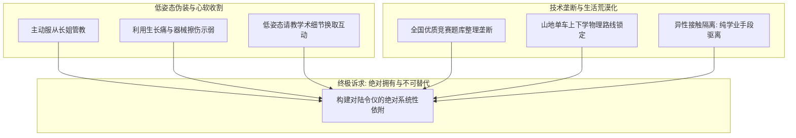

# 角色档案：沈策（Shen Ce）

> **“在复杂的力学平衡中，最高级的锁定从来不是用刚体强行箍紧，而是成为对方不可剥离的承重结构。”**

---

## 一、 基本档案与生理特征

| 属性 | 设定参数 | 补充说明 / 叙事意图 |
| :--- | :--- | :--- |
| **全名** | 沈策（邻里/发小昵称：“策策”；堂兄弟行二） | 策者，筹谋与规制。在同单元长辈发小口中是“懂事稳重的策策”。 |
| **叙事定位** | 男主角 / 战略博弈中枢 | 陆令仪生活习惯的无形编织者、理智外表下深藏独占欲的守护者。 |
| **出生日期** | 2007年4月29日 | 当前时间线（2019年秋）12岁；比陆令仪晚出生42天。 |
| **就读班级** | 江州一中 初一理科创新班 班长 | 数理竞赛断层第一，统领班级秩序与学科资源。 |
| **当前净身高** | 152.0 cm | **蓄力反差期**：比陆令仪矮5.5 cm。但**骨架宽厚，穿40码鞋**，医院骨龄片显示骨骺端极度活跃。 |
| **体格成长曲线** | **暴风拔节期预告** | 预计2020年居家网课与封闭期间突破 **172 cm**（彻底颠覆物理视线差），高中成熟期突破 **186 cm**。 |
| **体质与仪态** | 麦色精健、沉稳端正 | 常年随工程师父亲在社区健身区、江州理工大学田径场及业余拳馆锻炼；掌心宽厚温热，指节带有引体向上磨出的微黄薄茧。神情沉着冷峻，自带高校高级知识分子家庭特有的理性边界感。 |
| **随身物件** | 骑行手套、机械秒表、山地单车钥匙、整齐按学科装订的高难度竞赛题库、常温保温杯。 |

---

## 二、 智力模型与博弈内核

* **智力参数**：**IQ 144 / EQ 126**。
* **思维模型：机械空间直觉、系统推演与博弈论**
  * 融合了工程师父亲（沈振邦）的**精密机械空间感知**与高校博导母亲（温静姝）的**学术建模与推演能力**。
  * 极善于观察周围环境的微小变量，将人际关系转化为“阻力”、“支点”与“系统稳定性”，具有近乎苛刻的推演耐心。
* **双重气质与情感反差**：
  * **对外**：寡言清冷、情绪克制，与外界保持着高度自律的学者式疏离感。
  * **对陆令仪**：眼底所有的疏离瞬间瓦解，呈现出全神贯注的顺服、体贴以及深入骨髓的独占欲。

---

## 三、 核心博弈策略：战略侵略，战术退让

### 1. 战术示弱（精准撬动长姐心软）
* **主动交出统治权**：在外是说一不二的创新班班长，在陆令仪面前永远低头承认其“姐姐”权威，任由其翻看作业、纠正坐姿。
* **“少年创伤”变现**：
  * 利用田径单杠拉练磨破的手心擦伤、单车掉链蹭到的机油，主动摊在陆令仪眼前求助；
  * 夜自习后以骨骼暴涨引发的“生长痛”为由，低头靠在陆令仪桌旁寻求抚慰，用顺从与脆弱换取亲密肢体接触。

### 2. 社交荒漠化（技术与生活习惯垄断）
* **异性严格限流**：将陆令仪能正常交流的男生严格限制在**4人以内**（大院发小周浩、体委宋朗、劳委陈跃、极客徐一鸣），且全为工具属性。
* **生活与学业垄断**：
  * **学业端**：利用母亲高校重点实验室打印的全国奥赛绝密卷与名校内部资料，独家为陆令仪量身定制错题解析，使其学术探讨彻底绑定自己；
  * **生活端**：风雨无阻的单车接送、每日备好的温水、遮阳伞与自习室固定同桌，将陆令仪的生活节奏紧紧包裹在自己的重力场中。

### 3. 致命盲区：同性防线失守
* **合规假象**：
  * 受家庭传统知识分子严谨作风影响，其雷达完全集中在“驱逐试图靠近陆令仪的男生”上，**完全未将同性亲密纳入竞争变量**；
  * 面对优雅知性、主动帮忙剔除轻浮男生的沪上千金闻芷，沈策误以为找到了一个高情商、懂分寸的“外围安全隔离墙”，反而在无形中促成了闻芷对陆令仪的近距离攻势。

---

## 四、 行为细节与微表情刻画

* **习惯性护卫动作**：
  * 无论走在校道还是小区林荫路，永远自然落在陆令仪左后方半步或靠车道外侧，形成天然的视线遮挡与防护壁垒。
  * 骑车时永远保持在陆令仪右侧，红绿灯路口单脚点地，手扶车把微微侧头等待她的指令。
* **吃醋与压制手段（学霸级冷处理）**：
  * 面对外围男生的示好，从不诉诸粗暴打架，而是冷着脸用“次日模考单科压制对方30分”、“占满陆令仪所有课后讨论时间”以及“通知课代表当众批阅该生错漏”进行精准降维打击。
* **对陆令仪的专属依恋**：
  * 疲倦或生长痛发作时，会默默把额头抵在陆令仪校服后背，嗅着她身上淡淡的冷竹与洗衣皂清香，那是他焦躁内心唯一的镇静剂。

---

## 五、 时间线关键跨越与成长弧光（2019—2020）

* **初一上学期（2019秋）**：
  * 身高暂逊于陆令仪，甘当听话的“策策弟弟”，通过题库垄断与日常照顾稳步构建无菌气泡。
* **疫情封闭期（2020春）**：
  * 因两家同住一个教工与品质小区单元，网课与自习深度重合；
  * **身体暴风拔节**：半年内身高从152 cm飙升至172 cm，声线沉落、肩胛骨骤然拓宽，从“需要姐姐照料的弟弟”骤变为“极具雄性体格压迫感的挺拔少年”，彻底打破原有的体态平衡，引爆两人的荷尔蒙悸动。
