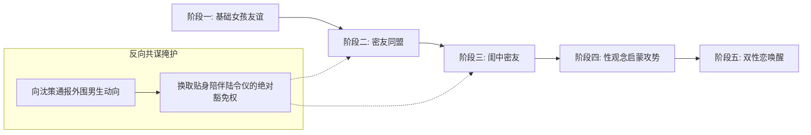

# 角色档案：闻芷（Wen Zhi）

> **“规则与说教能够修剪出一株完美的青竹，但唯有无声浸润的温水，才能让它舒展出柔软的枝叶。”**

---

## 一、 基本档案与生理特征

| 属性 | 设定参数 | 补充说明 / 叙事意图 |
| :--- | :--- | :--- |
| **全名** | 闻芷 | 语出“沅有芷兮澧有兰，思公子兮未敢言”，寓意清幽明艳、灵动温婉。 |
| **叙事定位** | 女二号 / 高维审美与情感渗透者 | 冲破传统中产规则防线的“破局者”，陆令仪的情感唤醒者与审美引路人。 |
| **出生日期** | 2007年2月 | 当前时间线（2019年秋）12岁；在同级生中月份稍大。 |
| **就读班级** | 江州一中 初一理科创新班 | 随家庭迁居由沪上名校转入，带来国际化视野与前沿审美观念。 |
| **净身高** | **168.0 cm** | **绝对物理高维优势**：早熟拔节，相比于157.5 cm的陆令仪与152 cm的沈策，具备显而易见的成熟女性身材压迫感。 |
| **容貌与体态** | 浓颜绝色、身段修长丰盈 | 腰细胸丰，骨相立体出众，眼若秋水、顾盼生姿；既有江南水乡的清丽温婉，又带有沿海时尚前沿培育出的松弛与从容。 |
| **专属香氛** | 白檀与冷调橙花香 | 私人定制级香气，前调清冽微苦，后调醇厚沉静，对被渗透者具有极强的安抚与嗅觉排他性。 |

---

## 二、 家庭背景与精神坐标

* **资本与阶层坐标**：
  * **父亲**：沪上知名外贸集团高管，涉足跨国供应链与全球商贸；
  * **母亲**：沿海知名独立品牌服饰主理人，兼具时尚触觉与现代商业头脑。
  * **家庭净资产**：约 **1200万～1500万**。
* **前卫文化与审美熏陶**：
  * 家境优渥充裕、父母思想极度开放前卫，给予闻芷充分的人格独立与审美自由，几乎不受传统应试与死板说教的束缚。
  * 相比于陆、沈两家带有浓厚中产高校学者与体制法律色彩的“谨小慎微、按部就班”，闻芷拥有对传统道德说教的**天然解构能力**与松弛感。

---

## 三、 性向认同与核心动机

* **性取向**：**纯粹而自洽的女同性恋（Lesbian）**。自我认同极早，内心对自己的取向笃定坦然，无半点内耗与负罪感。
* **锁定陆令仪的深层动机**：
  * 转入创新班第一天，便敏锐洞察到沈策对陆令仪那种包裹在“乖巧弟弟”外表下的独占欲，以及陆令仪在严谨家庭规则下的自律克制；
  * 在闻芷眼里，陆令仪像是一株被传统中产道德与学霸逻辑严密规训的孤傲细竹，纯净、自尊且内涵丰满；
  * **攻略心愿**：以细腻无害的温存与高维审美体验，将陆令仪从枯燥的理工做题、长辈的道德说教与男性的控制欲中“打捞”出来，让她领会同性之间至深至柔的灵肉共鸣。

---

## 四、 核心战术：高维渗透与情绪置换

### 1. 反向共谋（完美利用沈策的认知死角）
* **战术欺骗**：看准了沈策“只防雄性、不设防雌性”的传统中产直男思维定势。
* **甘当情报员**：在班级日常中，主动对沈策流露出对那些轻浮小男生的鄙夷，一旦有男生试图借笔记或搭讪陆令仪，闻芷第一时间便“善意提醒”沈策。
* **战术获利**：成功被沈策盖章为“思想端正、值得信赖的安全闺蜜”，获得了自习并坐、周末同去形体房、共同讨论作业的贴身特权。

### 2. 五步渗透战术模型
1. **基础女孩友谊**：以精致的小众手账本、进口护手霜与学习讨论为桥梁，优雅切入陆令仪的生活。
2. **密友同盟**：在日常交流中展现出毫不逊色于陆令仪的敏锐悟性与文学底蕴，成为精神上能够平等对话的朋友。
3. **闺中密友（突破私密边界）**：以舞蹈形体交流、穿搭指导为契机，自然深入陆令仪的私人形体室与卧房，轻易跨越沈策无法触碰的物理私密红线。
4. **性观念启蒙与审美攻势**：
   * 先用经典言情名著、青春纯爱小说作为掩饰借阅；
   * 随后不动声色地递出唯美同性爱恋小说、私人情书集与前沿情感读物，循序渐进地打破陆令仪传统的单一异性恋观念，改变并拓宽其性观念与亲密认知。
5. **双性恋唤醒（情绪与触觉置换）**：
   * 给予沈策绝不可能提供的“零压迫、纯柔软”身心体验（轻梳长发、调整肩带、深夜同榻听雨）；
   * 用白檀橙花的迷人香气与温柔体温，在陆令仪潜意识里种下对同性亲密的向往与依赖。

---

## 五、 行为细节与攻心微反应

* **身材视线压制**：
  * 凭借168 cm的高挑身高，在走廊或书架旁俯身靠近陆令仪，修长发丝垂在对方颈侧，用温润动听的嗓音轻语，营造视觉与气味的全包围。
* **润物无声的触碰**：
  * 随手为陆令仪抚平后颈翘起的发丝、在舞蹈镜前自然从背后环住其腰肢调整仪态，动作亲昵自然合乎常理，却在离开时留有意味深长的停顿。
* **与沈策交锋时的姿态**：
  * 面对沈策冰冷警惕的审视时，闻芷永远回以明媚得体、无可指摘的名媛微笑，眼神中却带着看穿对方“幼稚圈禁”的从容与嘲弄。

---

## 六、 剧作张力核心：闻芷 vs 沈策的隐形战争

* **手段代差**：沈策凭借数理题库与单车接送织成一道“工科物理网”；闻芷则借助前卫审美、同性共情与私密温存构筑“情感与性观念渗透梯”。
* **反噬爆发点**：当沈策在某一刻猛然惊觉闻芷不仅是闺蜜更是情敌时，陆令仪的心智早已接纳了闻芷的存在，令沈策陷入前所未有的博弈困局。
