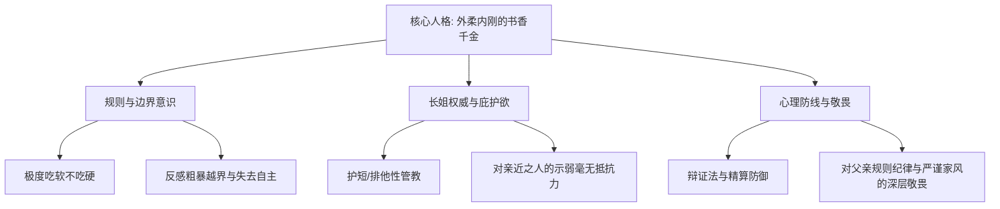

# 角色档案：陆令仪（Lu Lingyi）

> **“对立统一并非静止的妥协，而是彼此撕扯又无法割舍的动态依存。”**

---

## 一、 基本档案与生理特征

| 属性 | 设定参数 | 补充说明 / 叙事意图 |
| :--- | :--- | :--- |
| **全名** | 陆令仪 | 取自《诗经·小雅》：“令仪令色，小心翼翼。”寓意言行端庄、合乎法度。 |
| **叙事定位** | 女主角 / 第一人称视角（“我”） | 故事的核心观察者、价值判断中枢与情感拉扯焦点。 |
| **出生日期** | 2007年3月18日 | 当前时间线（2019年秋）12岁；比沈策早出生42天。 |
| **就读班级** | 江州一中 初一理科创新班 | 凭借卓越的综合素质与自律学业成绩考入。 |
| **净身高** | 157.5 cm | **生理俯视期尾声**：高出沈策5.5 cm，是维持其“长姐管教威严”的现实生理支点；但该优势正面临对方骨骼拔节的倒计时威胁。 |
| **体态气质** | 纤薄挺拔、骨相清绝 | 自幼在区少年宫与文化馆常年习练少年古典舞，身形纤细柔韧，天鹅颈、直角肩，背脊如出鞘细竹。初一发育期初显青涩轮廓，气质清冷自持。 |
| **气味标识** | 晨露冷竹与晒过阳光的纯棉白衬衫香 | 身上常带淡淡的草本清新香气与练字后的松墨气息，干净整洁，带有强烈的边界感。 |

---

## 二、 智力模型与思维框架

* **智力参数**：**IQ 139 / EQ 128**。
* **思维工具：法理红线、精算逻辑与唯物辩证法**
  * 继承了律所党支部书记父亲（陆明远）的**法理边界感与证据规则思维**，以及财务总监母亲（林知微）的**量化精算逻辑**。
  * 习惯运用清晰的规则界限与唯物辩证法拆解现实生活与学业难题，凡事讲求“主要矛盾”、“边界条件”与“对立统一”。
  * 面对青春期荷尔蒙骚动时，常下意识启动理智防御机制，试图以理性模型和规则定义将情感悸动“合理化”或“归因解构”。
* **行为习惯与秩序感**：
  * 具有严苛的时间切片与生活自律，书桌整理一丝不苟，记账与错题归纳条理分明。
  * 以极高的自律维持优异成绩与生活秩序，以此在严谨的书香家风中守住属于自己的精神掌控权。

---

## 三、 性格侧写与心理图谱

1. **外柔内刚，清冷自持**：
   * 受中产知识分子家庭熏陶，言行谦和有度、举止大方，但内心筑有清晰的界限。
   * 自尊心极强，吃软不吃硬。若有人强加干涉，会激起其冷冽的抵触；唯有真诚的依赖与低姿态示弱，能瞬间软化其防线。
2. **“长姐”情结与护短本能**：
   * 牢牢坚守“比沈策早出生42天”的既成事实，享受对其行使“姐姐”的督导、检查作业与生活管教权。
   * 极其护短——“沈策只有我能说教，旁人没有资格多嘴”。
3. **软肋与内在敬畏**：
   * **对规则与严谨家风的敬畏**：从小听从父亲对道德自律、法理纪律的强调，内心对任何“违背合规秩序”的行为怀有宿命式的自省与警惕。
   * **对情感失控的本能回避**：害怕理智天平倾斜，害怕自己习惯于沈策渗透过来的系统性依赖。

---

## 四、 核心情感动力学与博弈关系

### 1. 对沈策（男主角）—— 长姐威严与心动拉扯
* **动态张力**：**管教者与依赖者的身份错位**。
* **情感拉扯**：
  * *明面维度*：凭借5.5 cm的身高优势与年龄差，理所当然地检查沈策的作息、监督其单车骑行安全，维持长姐的体面与权威。
  * *暗面沦陷*：在沈策无微不至的全国竞赛题库垄断、单车后座接送、保温杯温水与生活照料中，已在潜意识里对他产生了不可剥离的习惯性依附。
  * *悸动与心惊*：看到沈策在高校田径场引体向上后汗湿的后背、手掌薄茧以及隐隐透出的筋骨硬度时，既有少女本能的心跳羞赧，又对即将被打破的“长姐俯视地位”感到隐隐的心慌。

### 2. 对闻芷（女二号）—— 棋逢对手的接纳与审美共振
* **动态张力**：**从“知己暖流”到“认知破壁”**。
* **情感演进**：
  * *初期感受*：被闻芷超越同龄人的优雅、前卫审美与江南烟雨般的柔和所吸引，在沈策带来的钢铁般严密保护外，感受到了同性专属的细腻温润。
  * *辩证认知*：在闻芷递来的文学作品与思想探讨中，陆令仪凭借唯物辩证法迅速击碎了传统世俗框架，在认知上接纳了同性爱恋的合理性。
  * *博弈回味*：她敏锐地察觉到了闻芷温水煮青蛙般的“攻略意图”，但因闻芷始终尊重其主体性与智力，陆令仪不仅不反感，反而享受这种势均力敌、暗流涌动的博弈兴致。

---

## 五、 行为细节与微反应刻画

* **被示弱破防时**：
  * 眼神由严肃挑刺瞬间转为无奈叹息，指尖轻轻抚平教案或笔记本边缘，嘴上严厉“下次不许再摔着”，手里却已利落拆开创可贴或递过温水。
* **思维沉浸时**：
  * 习惯用笔尾轻触下巴，视线微敛，如同母亲审核报表或父亲推演法条般专注，三言两语直切问题核心。
* **遭遇冒犯时**：
  * 脊背挺拔如竹，下巴微扬，用最冷静规范、挑不出任何礼貌破绽的语调划清界限，让试图逾矩者无所遁形。

---

## 六、 写作第一人称（POV）语音质感指引

* **视角语调**：冷静清澈、自省细腻，兼具古典文学的书卷气与逻辑清晰的规则感。
* **心理叙事特色**：
  * 善于用“规则”、“界限”、“对立与统一”剖析自己与沈策、闻芷的关系；
  * 第一人称内心自白常在“自尊长姐”与“心跳少女”之间横跳，充满细腻的心智交锋与荷尔蒙暗涌。
