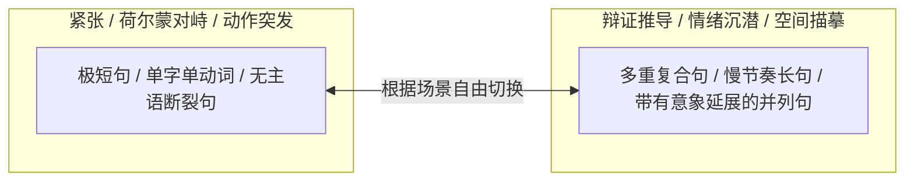

# 文笔规范：02_句式变化

> **核心维度**：句式变化  
> **具体要求**：长短句交替，节奏随情境与心智波动改变，形成有弹性的呼吸节奏  
> **应避免的AI倾向**：每句话字数接近，结构高度匀称，段落如排比文或公文摘要

---

## 一、 核心审美法则

句式是文学情绪的节拍器。**心跳加速、危险逼近或肢体触碰时，句子要碎、要短、要有窒息的骤停；哲学自省、回忆蔓延或环境沉浸时，句子要舒缓、要缠绕、要有从容的延宕。**

AI最致命的习惯是“语言平均主义”——每一句话都维持在15至25个字之间，主谓宾俱全，像被尺子量过一样死板。本作品必须打破这种机械对称，用参差不齐的句式创造鲜活的心理张力。

---

## 二、 句式调配指南

1. **短句与截口（用于压迫感、肢体接近、心跳失序）**：
   * 舍弃多余的连词与副词；
   * 采用动词独立成句、单字独顿；
   * 例：“他走近了。影子落下来。黑沉沉一片。”
2. **长句与回旋（用于唯物辩证思考、古典美学沉浸、回忆延展）**：
   * 利用偏正、定语后置或状语前置，让叙述带有一种冷冽的思辨美感；
   * 例：“我习惯在那些被父亲用红笔标出法律边界的卷宗边角，去推算一个由两个变量构成的非线性平衡，尽管我知道，所有的自律不过是给失控预设的堤坝。”
3. **长短错落的交响感**：
   * 绝对禁止连续出现三个结构、长度完全相同的并列句。

---

## 三、 正反案例深度对照

### 场景：沈策初二暴风拔节后，在自习室俯身给陆令仪讲题

#### ❌ 典型 AI 腔（长度均等、结构对称、毫无节奏波澜）
> 沈策手里拿着黑色的中性笔在白纸上飞快地书写着解题步骤。他的侧脸在昏暗的台灯光线下显得格外立体坚毅。陆令仪抬起头看着这个比自己高出许多的少年。她的心中感到了一丝莫名的慌乱与不知所措。整个教室里只能听见他们两人轻微的呼吸声。

#### ✅ 《过度拟合》规范写法（长短跌宕、急骤与延宕交织）
> 笔尖在草稿纸上划过去。  
> 刺啦一声，干脆利落。  
> 沈策撑在桌沿上的小臂已经拓宽成结实的骨架，带着热度的体温几乎贴着我的额发压下来。他穿40码鞋的大脚在课桌底下无意识往前探了半寸，鞋头撞在我的帆布鞋帮上。  
> 我没躲。  
> 但呼吸断了半拍。  
> 那道用引力场推导的压轴题只解了一半，他的声音却压得很低，变声期特有的沙哑像颗磨砂颗粒，顺着耳廓直直擦过去：“看懂了么，姐？”

---

## 四、 本作品写作自检清单

- [ ] 连续三句话的字数是否相差不足5个字？如果是，打碎其中一句，或合并两句。
- [ ] 在对峙、肢体碰撞的高潮节点，是否有长度超过30字的拖沓长句？（立即拆短）
- [ ] 是否在抒情段落出现机械的三段式排比句？（全部砍掉，只保留最锋利的一句）
- [ ] 标点符号是否丰富？（善用破折号、句号的骤停，杜绝全篇由逗号一逗到底）
