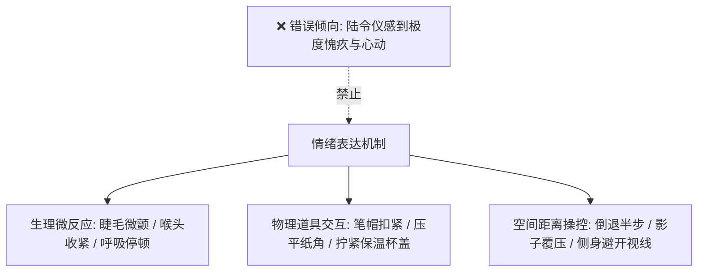

# 文笔规范：03_情绪克制

> **核心维度**：情绪克制  
> **具体要求**：通过生理反应、肢体微动作、道具交互与空间距离传达情绪（Show, Don't Tell）  
> **应避免的AI倾向**：上帝视角直接交代心理结论，充当“情绪说明书”，直白宣判人物的喜怒哀乐

---

## 一、 核心审美法则

**最高级的情感震颤，永远发生在沉默与克制之中。**  
读者不是靠作者在文本里宣告“他很嫉妒”来感受嫉妒的，而是靠看到**被捏变形的易拉罐、指节泛白的抓握、骤然移开的视线、吞咽时上下滚动的喉结**来感同身受。

《过度拟合》中的主要人物皆为极高智商、家教森严的中产高知子女，**“情绪高度自控、极少当众失态、用理性掩盖本能”**是他们的底色。文本绝不能变成情绪宣泄的廉价肥皂剧，必须保持外科手术般的冷峻与克制。

---

## 二、 “禁语词库”与克制替代原则

1. **全面清退直接描述情感的抽象形容词**：
   * ❌ 严禁出现：“感到十分难过”、“心里涌起一阵甜蜜”、“眼神中充满了占有欲”、“无比嫉妒”、“感到被冒犯的羞辱”。
2. **用“外化动作与生理本能”做等价置换**：
   * *想表达“嫉妒与独占”* $\to$ 描写沈策拇指死死按在单车铝合金刹把上，指骨凸起青白；
   * *想表达“长姐的心软与退让”* $\to$ 描写陆令仪嘴唇抿成一条白线，手里却将碘伏棉签在药瓶口轻轻刮掉多余药液；
   * *想表达“少女的羞怯与心慌”* $\to$ 描写陆令仪视线下意识盯住草稿纸上的某道墨斑，手指把校服袖口拉得极长，死死裹住手掌。

---

## 三、 正反案例深度对照

### 场景：沈策目睹竞赛尖子赵衡在走廊给陆令仪递笔记

#### ❌ 典型 AI 腔（说明书式心理交代、虚假直白）
> 看到赵衡站在陆令仪面前，沈策的心里瞬间涌起一股强烈的愤怒与嫉妒。作为创新班班长，他极其厌恶任何异性接近陆令仪。他觉得自己的领地受到了严重的侵犯。陆令仪抬起头，看到沈策那冰冷得像刀子一样的眼神，心中也不由自主地感到一阵心虚和歉疚。她知道，沈策又吃醋了。

#### ✅ 《过度拟合》规范写法（白描动作、冷峻张力、情绪隐藏在物象中）
> 赵衡把那本蓝色封皮的笔记往我窗台上推了推。  
> 话还没说完，后门处传来一声沉闷的铁皮撞击声。沈策单手拎着刚接满热水的太空杯走进来，路过窗台时脚步没停，只是手里的杯底“当”的一声搁在我桌角上，震得窗台上的墨水瓶晃了两晃。  
> 他没看赵衡，连余光都没往那边偏半寸。  
> “卷子第二道大题，你第二步用的积分模型是错的。”沈策拉开我前面的椅子坐下，后背绷得平整如铁板，把一张画满红叉的草稿纸反手拍在我眼前，声音冷淡得听不出起伏，“下午第一节课前改完，德育处要收。”  
> 赵衡伸在半空的手僵了一下，慢慢缩了回去。

---

## 四、 本作品写作自检清单

- [ ] 本章是否出现了“他感到……”、“她觉得很……”、“内心十分……”等句式？（见一个删一个，替换为肢体或视线动向）
- [ ] 人物的痛苦、心动或嫉妒，是否完全通过第三方的视觉或听觉细节能够被读者独立还原？
- [ ] 面对情感失控的高压场景，角色是否还在拼命维持礼貌或理性？（高智商人物越破防，言行越显得机械客套）
