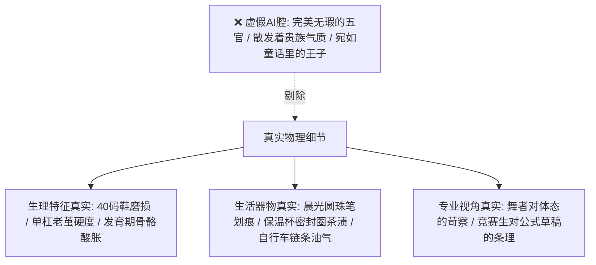

# 文笔规范：04_细节真实

> **核心维度**：细节真实  
> **具体要求**：描写具体、准确、具备实物触感，严格符合特定人物的专业背景与观察习惯  
> **应避免的AI倾向**：空泛、华丽、缺乏现实生活经验的塑料描写与偶像剧套路陈词

---

## 一、 核心审美法则

没有精确的细节，现实主义小说就是空中楼阁。**细节不能是抽象的华丽修饰，必须带有重力、摩擦力、气味和物质磨损痕迹。**

更重要的是，**细节必须符合第一人称观察者（陆令仪）的职业心理与认知习惯**：
1. **古典舞者的眼睛**：对骨相、肩胛骨开合、脊柱曲度、脚尖绷紧角度以及身体肌肉重心转移具备职业级的敏锐度；
2. **法政与精算家庭的烙印**：对时间秒数、笔墨克重、试卷折痕、因果逻辑漏洞拥有天然的审视本能。

---

## 二、 《过度拟合》三大核心主角标志性质感细节

### 1. 陆令仪的身体与生活细节
* **古典舞烙印**：脚趾大拇指内侧长期足尖点地磨出的硬皮、坐下时无论多累背脊自然与椅背保留两指空隙的肌肉记忆、天鹅颈在抬眸时的下颌收紧角。
* **书写与自律**：黑色0.5mm晨光按动中性笔，草稿纸永远沿中线对折四等分分栏书写，绝不容许大面积涂改黑团。

### 2. 沈策的机械工科与拔节期细节
* **手部触感**：手掌掌心与食指第二指节处，长年在高校操场单杠拉引体向上磨出的淡黄色硬茧，触碰皮肤时有沙沙的粗粝感；
* **拔节期狼狈与暴风成长**：初一还穿着略显空荡的40码回力球鞋，在初二课桌横梁下无处安放的长腿，因膝关节软骨狂飙生长而在深夜自习后下意识捶打膝盖骨的钝响。

### 3. 闻芷的沪上资本与前卫美学细节
* **气味与布料质感**：定制沙龙香中白檀木质与微涩橙花在体温烘烤下的后调扩散；羊绒针织衫边缘手工挑线的暗纹、第二颗天然贝母纽扣在日光灯下的虹彩光泽；
* **随身物件**：进口牛皮纸封面无酸纸笔记本、法式黄铜削笔刀、涂着半透明哑光护甲油的圆润指尖。

---

## 三、 正反案例深度对照

### 场景：陆令仪在洗手台旁撞见练完拳击器械回来的沈策

#### ❌ 典型 AI 腔（空泛、套路化、油腻偶像剧风）
> 沈策帅气地靠在墙边，浑身散发着阳刚而迷人的荷尔蒙气息。他的运动服被汗水微微浸湿，完美地勾勒出他那雕塑般的腹肌线条。阳光洒在他那刀削斧凿般的英俊侧脸上，显得格外出众。看到陆令仪走过来，他的嘴角勾起一抹邪魅的笑容，眼神里透着令人心动的深情。

#### ✅ 《过度拟合》规范写法（真实体感、气味、生理颗粒度）
> 洗手池的水龙头开到最大，冰凉的水流哗哗砸在白瓷盆底，溅起细密的水沫。  
> 沈策整颗脑袋几乎埋在水槽里，发尾全湿透了，往下滴着水珠。他刚从高校田径场引体向上和打沙袋回来，灰色的纯棉短袖前后心全被汗水浸成深深的一大坨暗色，紧贴着肩胛骨两块微微凸起的背阔肌。  
> 他直起身扯过挂在脖子上的白毛巾，粗粗抹了把脸。我递过去一包纸巾，他没接，直接把湿漉漉的手掌摊在我眼皮底下——虎口处被生锈的器械磨掉了一小块皮，翻着发白的死皮边，混着一点铁锈味的血丝。  
> “借点碘伏，”他嗓音哑得厉害，像喉咙里卡了把粗砂，“姐，骨头疼，使不上劲。”

---

## 四、 本作品写作自检清单

- [ ] 描写人物外貌时，是否出现了“剑眉星目”、“绝美”、“帅气”、“散发气场”等废话？（一律删去，替换为具体五官体态与光影特征）
- [ ] 场景中的道具是否具有年代与生活真实度？（如2019年的特定教辅名、折叠单车、晨光文具、学生水杯）
- [ ] 细节是否承担了揭示角色内在秘密的职能？（如沈策鞋码与手茧揭示其体格爆发，闻芷衣着揭示其审美阶层）
