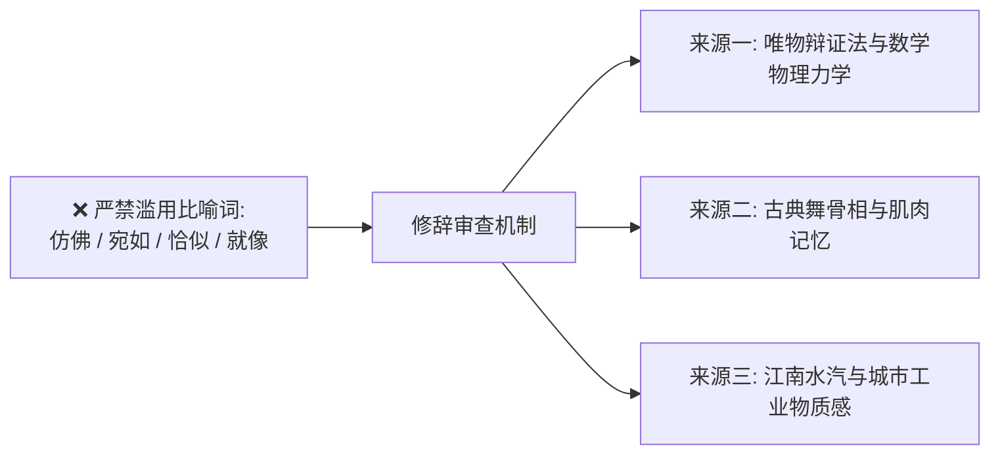

# 文笔规范：05_修辞节制

> **核心维度**：修辞节制  
> **具体要求**：白描为主，比喻宁缺毋滥；一旦使用，必须具备独创性、陌生化与精确的认知价值  
> **应避免的AI倾向**：动辄“仿佛”、“宛如”、“如同”、“像是”，通篇充斥陈腐、泛滥、自我感动的低级比喻

---

## 一、 核心审美法则

**比喻是文学的特权，滥用比喻则是写作能力的破产。**  
AI最大的恶习是“无句不比喻”，且翻来覆去都是“宛如黑夜的明灯”、“像一把锋利的尖刀”、“仿佛冰山消融”等毫无信息增量、甚至让人产生阅读疲劳的工业废话。

在《过度拟合》中，修辞必须遵循**“硬核学科化 + 真实感知化”**：
1. **源于角色知识结构**：比喻的本体与喻体，应来源于唯物辩证法、力学结构、机械公差、算法过度拟合、古典舞重力平衡与江州水网气候；
2. **能白描则绝不比喻**：准确的动词力量远大于花哨的喻体。

---

## 二、 彻底拉黑的陈腐比喻清单

* ❌ “他的目光仿佛一道闪电/寒夜里的流星……”
* ❌ “她的心跳宛如一只受惊的小鹿……”
* ❌ “他的占有欲如同一张无形的大网……”
* ❌ “闻芷温婉得就像江南烟雨中的水墨画……”
* ❌ “陆令仪的清高如同高山之巅盛开的雪莲……”
* ❌ “这股情感如同一团烈火瞬间点燃了空气……”

---

## 三、 正反案例深度对照

### 场景：描写沈策对陆令仪生活全方位的介入与依附感

#### ❌ 典型 AI 腔（比喻泛滥、俗套廉价、无实际质感）
> 沈策的关怀如同一阵温暖的春风，悄然吹进了陆令仪的心房。他就像是陆令仪身后一道永远无法摆脱的影子，宛如守护神一样时刻守护着她。他的存在仿佛是她生命中的阳光与氧气，让陆令仪的心中宛如打翻了五味瓶，既感到甜蜜，又仿佛深陷在某种不可名状的牢笼之中。

#### ✅ 《过度拟合》规范写法（白描为主，偶尔一击即中的力学/结构比喻）
> 沈策不爱在微信上多废话。但他把第二天的两张早自习数学卷、削好的铅笔、还有我车筐里换好的防滑车把套，全部按部就班地摆在我视线必须落脚的地方。  
> 他不是横冲直撞的入侵者。  
> 他像旧式砖混居民楼里暗暗浇筑的承重过梁。平时你甚至注意不到那道凸起的墙角，可一旦拆除，整层楼的灰浆就会扑簌簌往下塌。

---

## 四、 本作品写作自检清单

- [ ] 全文搜索“仿佛”、“宛如”、“如同”，出现频次是否每千字超过1次？（若超过，坚决删去或改写为直陈白描）
- [ ] 比喻句中的喻体是否与工业制造、法理逻辑、骨骼肌肉或江州生活相关？（拒绝风花雪月的老套言情意象）
- [ ] 如果把这句话里的比喻拿掉，原句的动作和事实陈述是否依然足够有力？（如果足够有力，坚决删掉比喻）
