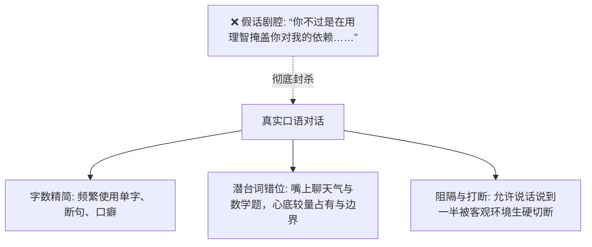

# 文笔规范：07_对话口语化

> **核心维度**：对话口语化  
> **具体要求**：允许停顿、抢话、打断、敷衍、口语杂质与答非所问，还原真实中学生与家庭生活语境  
> **应避免的AI倾向**：人人说话都像哲学家、心理咨询师或文学话剧演员，台词工整大段且直奔主题深层动机

---

## 一、 核心审美法则

**人类在真实生活中的对话，极少完整、深刻、且直击本质。**  
真实对话充满着：
1. **防御性的敷衍**：“嗯”、“随便”、“没怎么”、“选C”；
2. **答非所问与转移话题**：当被戳中痛处时，人往往用“你作业写完了吗”来掩盖慌乱；
3. **呼吸停顿与打断**：半截话被上课铃截断、被抽纸巾的声音打断、被喉咙里的咳嗽咽回去。

AI写对白最假的地方在于：**让十二三岁的中学生开口闭口全是心理学专业术语、人生哲学金句与极其工整的排比句。** 本作品严禁这种伪智力对白，越是深刻的情感，对白越要日常、简短甚至带有毛边。

---

## 二、 角色台词个性化语言指引

* **沈策（极简、低沉、工科指令化、示弱时沙哑）**：
  * 对外人几乎只有单音节：“没带”、“不知道”、“不借”；
  * 对陆令仪从不长篇大论，多为短促的事实提示或低姿态央求：“喝水”、“第二题看第三行”、“车胎给你打满了”、“姐，帮我贴一下创可贴”。
* **陆令仪（清冷、规整、辩证法口癖、吃软不吃硬）**：
  * 习惯用规矩敲打沈策：“手放好”、“别坐没坐相”、“这是两码事”；
  * 面对沈策示弱时，语调虽硬但句子会变碎：“知道了……下次再摔着别找我……听见没有？”
* **闻芷（温润、尾音微拖、名媛轻柔、话里带钩）**：
  * 不说硬话，擅长用亲昵反问：“令仪，周末陪我去买颜料好不好呀？”、“某些男孩子，管得可真宽呢”。

---

## 三、 正反案例深度对照

### 场景：陆令仪检查沈策的数学错题，沈策身体挨得太近

#### ❌ 典型 AI 腔（人人都是心理学大师、戏剧念白）
> 陆令仪皱起眉头看着沈策，严肃地说道：“沈策，你靠我这么近，难道不是在潜意识里试图突破我们姐弟之间的心理边界吗？你在用你的物理压迫感，强行挑战我的长姐权威。”  
> 沈策目光深邃地注视着她，低沉地反驳道：“姐，你之所以这么紧张，是因为你的内心深处也在害怕失去对我绝对的掌控权。我们之间的关系从来就不是简单的对立，而是灵魂深处的互相依附，你难道还不承认吗？”

#### ✅ 《过度拟合》规范写法（真实口语、有刺有温、含蓄带毛边）
> 我用笔杆敲了敲桌面：“往后挪挪，挡光了。”  
> 沈策没动，身子依然低着，额前的碎发几乎要扫到我手背：“第三问的辅助线怎么连？”  
> “坐回去就告诉你。”  
> “膝盖疼，站不直。”他声音压得又低又含糊，带着变声期的沙哑，喉咙咕噜了一声，“真疼。”  
> 我侧头看了他一眼。他下巴抵在课桌角上，眼皮耷拉着，一副任杀任刮的无赖相。  
> “……手伸出来。”我叹了口气。  
> “干嘛？”  
> “拿红花油给你揉揉，少废话。”

---

## 四、 本作品写作自检清单

- [ ] 是否有单人连续发言超过三行（60字）以上的大段独白？（若有，打碎它，插入动作或打断）
- [ ] 人物对话中是否出现了“潜意识”、“支配欲”、“掌控权”、“边界感”等理论词汇？（绝对禁止人物在台词中直接说出理论名词！）
- [ ] 对话中是否保留了“嗯”、“行”、“那个”、“啧”等真实汉语语气停顿？
