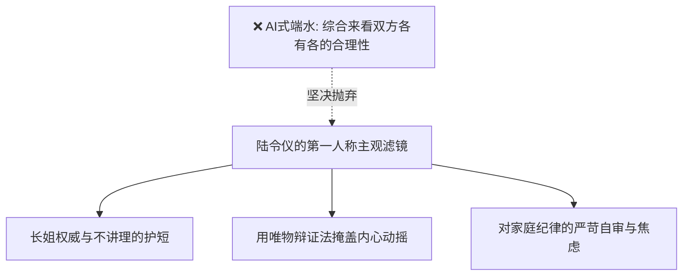

# 文笔规范：08_作者主观性

> **核心维度**：作者主观性（第一人称 POV 滤镜）  
> **具体要求**：坚守独特的观察棱角，允许叙述者拥有偏见、私心、盲点与辩证执念  
> **应避免的AI倾向**：永远客观、绝对中立、面面俱到、各打五十大板的“公文式端水”

---

## 一、 核心审美法则

**第一人称（POV）叙事的核心魅力，正在于其“不可靠性”与“强烈的主观滤镜”。**  
AI最根深蒂固的代码本能是“中立端水”——每当描写冲突，它必定要面面俱到地分析：“A固然有错，但B也有不妥，从宏观来看大家都是身不由己……”这种写作完全扼杀了文学的尖锐与生命力。

在《过度拟合》中，陆令仪是**带着强烈家风烙印、高度自尊且极度护短**的叙述者：
1. **长姐的私心与偏袒**：沈策在外面搞霸道垄断，她嘴上批评，心底却天然有一种“自家弟弟再蛮横也容不得外人置喙”的护短本能；
2. **知识分子的自欺欺人**：每当她对沈策的身体接近产生少女羞怯时，她会熟练地调用“唯物辩证法”进行理论包装，强行把生理悸动合理化为“对立统一规律”；
3. **主观视角的盲区**：正因为她是主观的第一人称，她才会最初完全被闻芷的温柔迷惑，察觉不到沈策早已将自己当成终极猎物的危险性。

---

## 二、 拒绝“AI端水大师”的反向自律

* ❌ 严禁出现：“一方面……但从另一个角度来说……”
* ❌ 严禁出现：“客观地说，沈策的行为是不可取的，但他……”
* ❌ 严禁出现：“无论对错，每个人都在自己的世界里努力生活……”
* **原则**：让陆令仪带着尖刺去观察，带着私心去裁决，带着少女的自尊与傲骨去审视周遭的一切。

---

## 三、 正反案例深度对照

### 场景：陆令仪在内心审视沈策用学术霸权把赵衡“公开社死”事件

#### ❌ 典型 AI 腔（客观公允、理中客大道理、毫无血肉）
> 客观地说，沈策当众指出赵衡解题漏洞的行为，确实有些过于苛刻与不近人情了。这体现出了他在青春期对异性接触的不成熟防卫机制。然而从另一个角度来看，沈策也是出于对我的关心与保护。虽然他的手段有些偏激，但其背后的深情是值得理解的。在这场博弈中，没有真正的赢家，大家都只是被青春期的荷尔蒙所左右罢了。

#### ✅ 《过度拟合》规范写法（鲜明主观偏袒、傲慢、辩证法自欺）
> 沈策在黑板上把赵衡那道题撕得粉碎的时候，手段确实算不上体面。  
> 换作别人，我大概会直接扣他一个“破坏同学团结”的帽子，让他在班会上做检讨。  
> 但看着赵衡涨成猪肝色的脸，我低头转了转笔，到底没吭声。在矛盾的主要方面和次要方面里，赵衡那种漏洞百出的虚荣解法，本来就该挨刀子；沈策不过是顺手当了那把手术刀。  
> 至于沈策那点见不得光的心思——我盯着他被校服撑得平直的后脑勺，心里冷笑了一声：小崽子，借公谋私，账等回了小区再跟你算。

---

## 四、 本作品写作自检清单

- [ ] 第一人称“我”是否流露出了真实的私心、偏见或小虚荣？（有，才是活生生的人）
- [ ] 文本中是否存在“客观评价”、“不可否认”、“平心而论”等理中客公文腔？（全部删去）
- [ ] 陆令仪的叙述是否具有刺感？（她的教养虽然温和，但内心的刀子极快极准）
