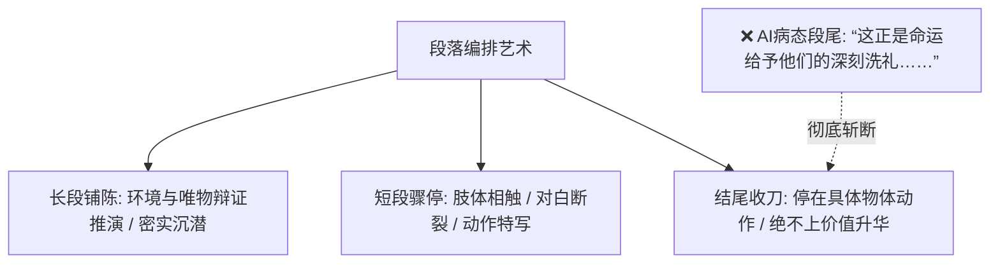

# 文笔规范：10_段落节奏

> **核心维度**：段落节奏  
> **具体要求**：根据叙事起伏自由分段，长段凝练沉浸，短段如刀断流  
> **应避免的AI倾向**：段落长度高度均等，且每个段落末尾必定强行“上价值”、“升华命运”、“抒发人生感慨”

---

## 一、 核心审美法则

**段落是视觉上的呼吸空隙，也是心理时间的切片。**  
AI最刻板的排版恶习是：
1. **等长段落强迫症**：每一段固定在4行到6行之间，像一块块整齐划一的预制板；
2. **段尾必须升华病（致命AI毒斑）**：每一段写完，最后一句必定要来一句自以为深刻的感慨：“而这一切，都在暗中预示着命运的转折……”、“青春的心事，正如那盛夏的蝉鸣，终究消散在风里……”

在《过度拟合》中：
* **动作对峙、肢体侵入时**：允许单字成行、单句成段，创造骤停与失重感；
* **思想辩证、环境浸润时**：允许密实的长段落，一气呵成；
* **段落结尾的收刀艺术**：**段尾落在具体的声音、动作或光影上，绝不强行总结上价值！**

---

## 二、 坚决清除的“段尾升华式套话”

* ❌ “而这一切，不过是暴风雨来临前的宁静罢了。”
* ❌ “或许，这就是青春最真实的底色。”
* ❌ “命运的齿轮，在这一刻悄然转动。”
* ❌ “在那个蝉鸣喧嚣的夏天，有些东西终究不一样了。”
* ❌ “这不仅是一场较量，更是一场关于成长的洗礼。”

---

## 三、 正反案例深度对照

### 场景：沈策初二疫情网课结束后，第一次站在陆令仪面前，身高突破172 cm

#### ❌ 典型 AI 腔（均等段落、每段末尾疯狂上价值升华）
> 漫长的居家网课终于结束了，江州一中的校园里再次恢复了往日的生机。陆令仪走在熟悉的校道上，心中感慨万千。阳光透过树叶的缝隙洒下来，宛如斑驳的碎金。或许，时间的流逝总是在不经意间改变着所有人，而这一切都在预示着新篇章的开启。  
> 
> 这时，沈策迎面走了过来。当陆令仪抬起头看向他时，整个人都愣住了。曾经那个需要自己低头照顾的弟弟，如今已经长成了挺拔的少年。他的肩膀变得宽阔，眼神也变得更加坚定。这不仅是身体发育的奇迹，更是时光在少年身上烙印下的成熟印记，让青春的悸动在这一刻化作了永恒。

#### ✅ 《过度拟合》规范写法（参差错落、结尾定格于物象与冷峻动作）
> 走廊尽头的水磨石地坪刚拖过，泛着一层湿漉漉的腥气。  
> 
> 我手里拿着两个人的物理实验报告，刚转过楼梯拐角，视线冷不丁撞上一堵挡在眼前的蓝白校服。  
> 
> 习惯性地微仰起头。  
> 
> 没看到沈策的眼睛。  
> 
> 视线正正落在他锁骨下方微凸的胸骨上。  
> 
> 晨光从他宽阔的肩膀后侧打过来，把我整个人严严实实扣在他的影子里。他身上带着一股极清淡的肥皂味，混着一点少年暴涨骨骼特有的干燥温热，从头顶直压下来。  
> 
> 40码球鞋在地面上踏出沉闷的一声响。  
> 
> 沈策垂下眼帘，喉结上下滚动了一下。  
> 
> “姐。”  
> 他开口，声音粗粝低沉，彻底褪掉了童音，“报告我替你交。”  
> 
> 他伸手抽走我手里的夹子，指腹粗糙的单杠老茧擦过我的手背。

---

## 四、 本作品写作自检清单

- [ ] 检查每个段落的最后一句话：是否带有“或许”、“终究”、“命运”、“青春”、“洗礼”等试图当人生导师的词汇？（有则立刻删掉整句！）
- [ ] 是否敢于让段落停在“他关上了门”、“水龙头滴答响了一声”等纯客观物理细节上？
- [ ] 页面在视觉排版上，是否有长有短、疏密相间，呈现出类似现代诗或乐谱的起伏感？
