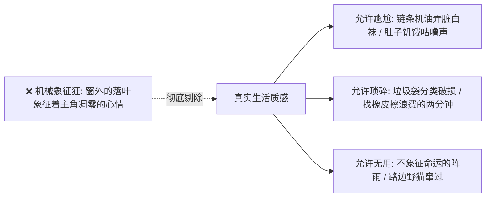

# 文笔规范：11_生活质感

> **核心维度**：生活质感  
> **具体要求**：允许琐碎、平庸、尴尬、无意义的停顿与不完美，还原真实的市井与校园烟火  
> **应避免的AI倾向**：工具主义描写狂，非要让每一个道具、每一滴雨、每一只飞鸟都承担沉重的剧情任务或象征隐喻

---

## 一、 核心审美法则

**生活并非剧本，它充满了大量“无用却真实”的边角料。**  
AI最机械的毛病是**“功利主义象征狂”**：如果下雨，那必定象征着人物内心的悲伤；如果窗前落了一只麻雀，那必定象征着渴望自由；如果主角碰了一下手，那必定要触发一段命运契约。这种写法把小说抽干了人间烟火气，变成了冷冰冰的符号游戏。

在《过度拟合》中，必须保留生活的粗糙边缘与平庸真实：
1. **真实的生理与狼狈**：换季时的鼻炎喷嚏、剧烈运动后的汗臭味、长个子时膝关节酸胀得想踹墙的烦躁、古典舞练功后脚趾磨破的水泡；
2. **校园与家庭的烟火杂质**：早自习黑板擦拍在水泥台上的白灰扑腾、书包侧袋漏掉的温水打湿了卷子一角、自行车后座被雨水淋湿用卫生纸擦拭的尴尬碎屑；
3. **“无意义”的停顿**：角色有时就只是在等红绿灯时发呆看路边环卫工人扫树叶，纯粹为了生活的质感而存在。

---

## 二、 拒绝“符号化悬浮”的自律法则

* ❌ 严禁让角色生活在无菌真空偶像剧里（如：出汗永远是晶莹香甜的、衣服永远纤尘不染、家庭永远只有宏大辩论没有柴米油盐）。
* ❌ 严禁将每一个物理道具赋予沉重的形而上学隐喻。
* **准则**：自行车掉链子，首先是因为链条锈了缺机油，其次才是沈策借机修车；早自习发困，首先是因为昨晚刷题到凌晨一点半缺觉，而不是“陷入了对未来的深刻迷茫”。

---

## 三、 正反案例深度对照

### 场景：早晨文萃苑小区单元楼门前，两家准备出发去一中

#### ❌ 典型 AI 腔（悬浮高贵、不食人间烟火、处处象征命运）
> 清晨的第一缕阳光洒在静谧的教工小区里。陆令仪身穿一尘不染的校服，宛如晨光中优雅的天鹅。她背着书包走出楼门，心中带着对新一天的无限憧憬。沈策早已站在那里等候，他的单车在朝阳下泛着银色的光芒，那辆单车不仅是交通工具，更是他通向她内心世界的心灵之舟。两人相视一笑，命运的羁绊在无声中加深。

#### ✅ 《过度拟合》规范写法（琐碎、生动、带有市井尘土与真情实感）
> 单元门底下那个防撞吸铁石坏了，门被穿堂风猛地摔上，“咣当”一声巨响，震得楼道里的感应灯全亮了。  
> 我嘴里还叼着半片抹了花生酱的全麦吐司，右手忙着把滑下肩膀的水壶带子往上捞。林知微在二楼阳台推开窗户喊了一声：“陆令仪！你校服外套拉链拉上！江边降温七度呢！”  
> 我没回头，含糊应了一句，一口把吐司硬咽下去，噎得胸口发堵。  
> 沈策在车棚前低头系鞋带。他的白球鞋鞋头蹭了一块黑机油，怎么擦也没干净，鞋带被他踩松了，在地上拖得全是灰。听到动静，他单手把车把扳正，顺手从车筐里摸出一盒温热的利乐包纯牛奶，吸管已经啪嗒一声戳好了，直直递到我下巴底下。  
> “咽下去，”他看都没看我脖子，眼神落在路边翻垃圾桶的黄猫身上，“别噎翻了还得我背你。”

---

## 四、 本作品写作自检清单

- [ ] 场景里是否出现了真实生活中的“微小尴尬”或“意外琐碎”？（如笔水漏了、鞋带散了、咽东西噎着了、钥匙找不到了）
- [ ] 描写天气（如江州的梅雨、冬天的湿冷）时，是否单纯还原了空气潮湿阴冷的物理体感，而不是强行煽情？
- [ ] 陆家与沈家的生活是否带有真实的柴米油盐与账单精打细算？（如林知微对菜价的留意、沈振邦手上的机油洗涤剂味）
