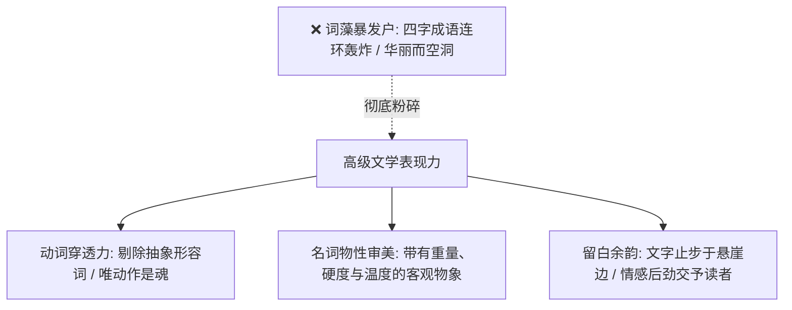

# 文笔规范：12_文学表现力

> **核心维度**：文学表现力  
> **具体要求**：追求汉语的高级质感——动词的精准穿透力、审美选择的冷冽自持与情感后劲  
> **应避免的AI倾向**：将“文学性”误解为“辞藻丰富”，堆砌生僻字、连环四字成语与暴发户式的华丽形容词

---

## 一、 核心审美法则

**文学表现力的顶峰，是“极度准确”带来的震撼，绝非“堆砌形容词”的浮夸。**  
AI最大的文风陷阱，是将“辞藻丰富”等同于“文学底蕴”——动辄“光风霁月”、“绝代风华”、“浩瀚深邃”、“摄人心魄”，一句话里塞下四个成语，看似花团锦簇，实则空洞贫瘠，一戳即破。

在《过度拟合》中，文学表现力体现为：
1. **精准动词的千钧之力**：用一个极准确、甚至略带生涩的日常动词，钉死人物当下的心理状态；
2. **名词的颗粒度与物性**：选用有重量、有时代印记与质感的具体名词（如“铅皮”、“骨骺”、“法向力”、“白檀”、“冷雨”）；
3. **冷冽而深情的审美选择**：文字表面如同冰封江面般平滑克制，底下却奔涌着万钧暗流，读完让人胸口发紧，余音数日不绝。

---

## 二、 必须永久销毁的“虚假文采词库”

* ❌ 连环成语堆砌：“惊心动魄、扣人心弦、光怪陆离、跌宕起伏”
* ❌ 廉价古风/网文大词：“倾城一笑”、“惊为天人”、“深邃莫测”、“绝世无双”
* ❌ 空洞情感大词：“刻骨铭心”、“痛彻心扉”、“悲喜交加”、“无尽的狂澜”
* **铁律**：一页纸内严禁连续出现两个四字成语。能用两个字的动词说清的，绝不用四个字的成语。

---

## 三、 正反案例深度对照

### 场景：陆令仪在文化馆练功房独处，练完高难度古典舞控腿与跳跃

#### ❌ 典型 AI 腔（辞藻堆砌、成语连环炸、空洞无物）
> 陆令仪在宽敞明亮的形体房中翩翩起舞，宛如一只高贵优雅的白天鹅。她的舞姿轻盈曼妙、倾国倾城，光风霁月般的面容上带着令人心醉的清冷出尘。每一次跳跃都惊心动魄，每一次旋转都美轮美奂。汗水浸湿了她那绝美的身段，却丝毫无法掩盖她身上散发出的摄人心魄的艺术魅力与独特灵魂。

#### ✅ 《过度拟合》规范写法（动词精准、冷冽骨感、审美自洽）
> 音乐在最后一个降B小调上骤停。  
> 
> 我左足单立，右腿在把杆正上方绷到一百七十度，肌肉剧烈颤抖了三秒，才慢慢收拢回五位脚。脚踝骨处的韧带火辣辣地扯着疼，像有一根细铁丝在肉里缓慢拉锯。  
> 
> 练功房里没有开大灯，只有临街窗户透进来的铅灰色黄昏。墙面整面巨大的水银镜被呼出的热气熏上一层白雾，模糊地映出一个弓着背、大口喘息的青涩剪影。  
> 
> 汗水顺着天鹅颈的凹槽往下淌，滑过锁骨，无声砸在起皮的松木地板缝里。  
> 
> 我抬手用掌心狠狠抹掉睫毛上的盐分，直起脊背，下颌重新微扬三度。镜子里的影子一动不动，挺立得像一节在寒风里被冻硬了的细竹。

---

## 四、 本作品写作自检清单

- [ ] 是否存在为了“显得有文采”而强行插入的生僻字词或四字成语？（如果有，替换为最质朴精准的词语）
- [ ] 句子是否经得起推敲：每一个字是否都在传递具体的物理信息（温度、痛感、光线、声音）？
- [ ] 读完全段，是否产生了一种带有江南微冷水汽与理性克制美感的“通感体验”？
