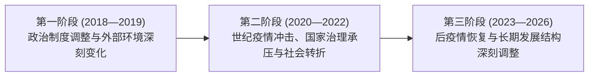
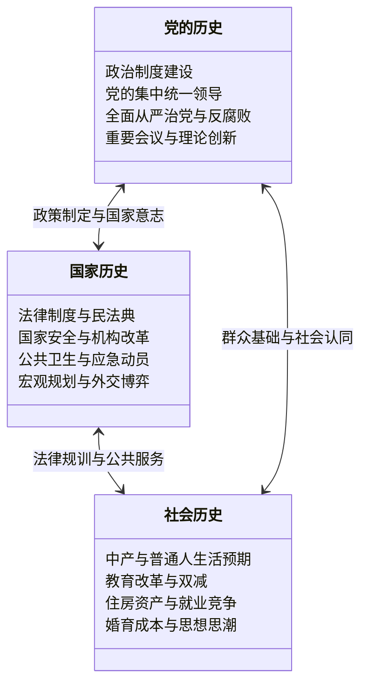
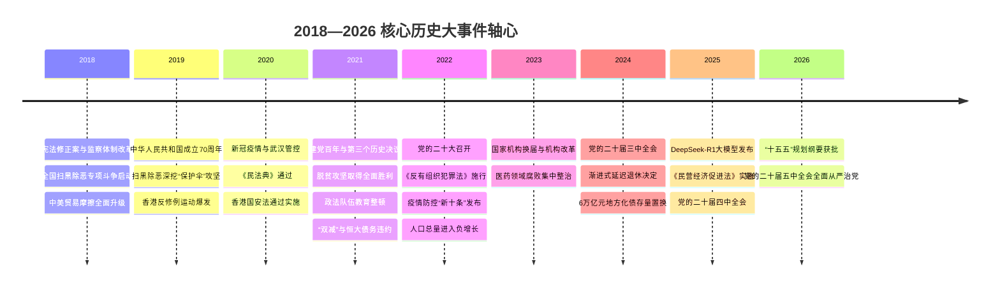

# 时代背景总则：中国2018—2026年重大历史全史（纲要与宏观架构）

> **时间跨度**：2018年1月 — 2026年11月2日  
> **核心向度**：党史 · 国家史 · 社会史 · 经济史 · 法治史 · 科技史 · 外交史  
> **叙事目的**：构建现实主义底座，阐明政治制度、国家治理、宏观经济与微观社会生活（普通人、中产家庭与青年群体）之间的结构性互动。

---

## 一、 宏观历史定位与三阶段划分

2018年至2026年，是中国政治制度、国家治理、经济结构和社会生活发生深刻变化的八年。从整体演进脉络看，可划分为三个特征鲜明的历史阶段：

### 1. 第一阶段｜2018—2019：政治制度调整与外部环境变化
* **核心动向**：修宪、深化党和国家机构改革、国家监察体制改革落地；启动为期三年的全国扫黑除恶专项斗争；中美贸易摩擦全面爆发。
* **时代切片**：国家权力集中统一领导进一步强化，基层治理向纵深穿透；社会层面开始反思互联网996超时用工、疫苗安全及金融借贷风险。

### 2. 第二阶段｜2020—2022：重大危机、国家治理与社会转折
* **核心动向**：新冠疫情暴发并演化为全球大流行；扫黑除恶专项斗争收官并转入常态化；脱贫攻坚战全面胜利；《民法典》出台与香港国安法实施；建党百年与党的二十大召开；年底疫情防控政策重大调整。
* **时代切片**：全社会经历前所未有的公共卫生压力测试，健康码、网课与居家办公普及；人口总量在2022年首次出现负增长；恒大债务危机爆发拉开房地产深度调整序幕。

### 3. 第三阶段｜2023—2026：后疫情恢复与深层结构转型
* **核心动向**：国家机构换届；党的二十届三中、四中、五中全会相继召开，部署进一步全面深化改革、“十五五”规划及全面从严治党；实施渐进式延迟退休与国家育儿补贴制度；高科技（DeepSeek-R1、新能源产业链）迅猛突破。
* **时代切片**：经济从“地产与基建驱动”艰难转向“新质生产力与先进制造”；普通家庭财富预期收缩，青年就业竞争加剧，“内卷”、“躺平”与人口老龄化成为长期社会议题。

---

## 二、 三维一体的观察视阈

1. **党的历史（政治中枢）**：
   * 坚持和加强党中央集中统一领导，推进政治制度与纪检监察体制改革；
   * 全面从严治党由浅入深，覆盖中央地方党政、政法系统（教育整顿）、医药领域直至军队高层。
2. **国家的历史（治理机器）**：
   * 法治体系从民事基本法（《民法典》）延伸至反有组织犯罪、个人信息保护、反间谍、民营经济促进法及国家发展规划法；
   * 面对重大公共卫生事件、极端气候灾害与金融风险展现出强大的统筹动员力，同时也暴露了基层执行弹性与预警机制的复杂课题。
3. **社会的历史（微观人生）**：
   * **国家发生的历史 $\neq$ 普通人实际经历的历史**；
   * 同一项政策（如扫黑除恶、双减、疫情防控、延迟退休），在中产知识分子家庭、普通工薪阶层与青少年学生身上产生着截然不同的人生轨迹与心理印记。

---

## 三、 专项深度：2018—2020年全国扫黑除恶专项斗争

作为这八年间对基层政权、司法生态和社会治安影响最深远的行动，扫黑除恶不仅是一场治安战役，更是一次深刻的基层权力净化工程。

### 1. 三年专项斗争核心数据（官方公开统计）
* **涉黑涉恶组织处置**：打掉涉黑组织 **3,644个**，打掉涉恶犯罪集团 **11,675个**；
* **人员抓获**：抓获犯罪嫌疑人 **23.7万人**；
* **“打伞破网”深层追责**：涉黑涉恶腐败与“保护伞”问题立案处理人员达 **11.59万余人**。

### 2. 标志性大案与制度警示
* **云南孙小果案**：揭露了跨越数十年的违规减刑、保外就医与政法司法系统利益输送网；
* **湖南新晃“操场埋尸案”**：揭露了基层黑恶势力勾结公职人员、造成重特大命案沉冤十六载的恶劣事实；
* **历史定论**：证实黑恶势力的盘踞不仅仅是暴力犯罪，本质在于地方权力失范与监督机制失效。

### 3. 法治化过渡
* **2021年**：宣布专项斗争取得全面胜利，正式转入“常态化扫黑除恶”；
* **2022年5月1日**：《中华人民共和国反有组织犯罪法》施行，将专案运动式治理经验沉淀为长期法定规范。

---

## 四、 2018—2026年重大制度与法律变迁矩阵

| 实施年份 | 法律 / 重大制度改革 | 核心治理领域 | 对微观社会生活的影响 |
| :--- | :--- | :--- | :--- |
| **2018** | 宪法修正案 / 国家监察体制改革 | 国家领导体制与公职监察 | 设立国家监察委，公权力监督实现全覆盖。 |
| **2020** | 《中华人民共和国民法典》通过 | 基础民商事权利体系 | 确立人格权、居住权、离婚冷静期等民事基本秩序。 |
| **2020** | 香港特别行政区维护国家安全法 | 特别行政区安全与秩序 | 迅速平复社会动荡，确立“爱国者治港”原则。 |
| **2021** | 《个人信息保护法》/ 反垄断监管 | 数字经济、数据主权与隐私 | 规制平台算法与过度索权，终结互联网无序扩张。 |
| **2021** | 义务教育“双减”政策出台 | 基础教育与校外教培生态 | 彻底重塑中小学课后生态，教培行业发生历史性出清。 |
| **2022** | 《中华人民共和国反有组织犯罪法》 | 常态化打击黑恶与追索涉案资产 | 明确“保护伞”查处机制，规范预防与财产处置。 |
| **2023** | 全国医药领域腐败集中整治 | 医疗卫生采购与处方回扣治理 | 破除医患利益输送灰色空间，冲击医药学术营销。 |
| **2024** | 渐进式延迟法定退休年龄决定 | 劳动用工、养老金与退休制度 | 改变青年至中年群体的职业生命周期预期。 |
| **2025** | 《中华人民共和国民营经济促进法》 | 市场准入、产权保护与营商环境 | 稳定民营企业家预期，以国家法律保障公平竞争。 |
| **2025** | 全国统一育儿补贴制度落地实施 | 生育支持体系与家庭减负 | 3岁以下每人每年3600元基准，应对人口老龄化。 |
| **2026** | 《国家发展规划法》通过 | 宏观规划法定化与“十五五”实施 | 确立五年规划的法律地位与全过程监督实施机制。 |

---

## 五、 最具历史决定性的25个核心节点（2018—2026）

1. **2018**：宪法修正案通过与国家监察委员会成立
2. **2018**：全国扫黑除恶专项斗争启动
3. **2018**：中美经贸摩擦全面升级
4. **2019**：中华人民共和国成立70周年盛大庆典
5. **2019**：扫黑除恶重大案件深挖“保护伞”（孙小果案、操场埋尸案）
6. **2019**：香港反修例运动引发社会重大危机
7. **2020**：新冠疫情暴发与武汉离汉通道管控
8. **2020**：《中华人民共和国民法典》表决通过
9. **2020**：香港特别行政区维护国家安全法颁布实施
10. **2021**：中国共产党成立100周年大会与第三个历史决议
11. **2021**：宣布脱贫攻坚战取得全面胜利
12. **2021**：全国政法队伍教育整顿全面推开
13. **2021**：“双减”政策出台与恒大暴雷引发房地产行业深度调整
14. **2022**：中国共产党第二十次全国代表大会召开
15. **2022**：《中华人民共和国反有组织犯罪法》正式施行
16. **2022**：疫情防控“新十条”出台与防控策略转向
17. **2022**：中国大陆总人口出现历史性负增长（较上年减少85万）
18. **2023**：国家机构换届与深化党和国家机构改革
19. **2023**：全国医药领域全链条腐败集中整治启动
20. **2024**：党的二十届三中全会通过进一步全面深化改革决定
21. **2024**：全国人大常委会通过渐进式延迟法定退休年龄决定
22. **2024**：批准增加6万亿元地方政府债务限额置换存量隐性债务
23. **2025**：DeepSeek-R1大模型引爆全球与《民营经济促进法》实施
24. **2025**：党的二十届四中全会审议通过“十五五”规划建议
25. **2026**：全国人大批准“十五五”规划纲要与党的二十届五中全会部署全面从严治党

---

## 六、 时代背景与小说叙事微观互嵌指引

在《过度拟合》作品中，该时代背景不是机械的年表背景板，而是直接塑造人物性格、家庭抉择与心理博弈的**结构性重力场**：

1. **中产知识分子家庭的规则敬畏与资产焦虑**：
   * 陆明远（律所合伙人兼党支部书记）对规则法理的严防死守，直接映射了全面依法治国与民法典时代的严谨；
   * 林知微（科技上市公司CFO）在2019年研发加计扣除与2020年初居家保全现金流的忙碌，映射了宏观财税与抗疫保障；
   * 沈振邦（汽配企业技术总监）2019年攻关新能源模具、2020年初复工复产，映射了中国制造业转型与硬核坚守；
   * 温静姝（高校计算机副教授）2020年网课教学与自然语言处理科研，折射了知识分子的学院生态。
2. **主角成长的时代烙印**：
   * 2019年秋季（初一创新班开学）：大考竞赛、996与学业竞争、中产家庭“不能输”的学业投资；
   * 2020年春季（疫情网课与小区封闭）：两家同单元隔离、沈策在骨龄暴风拔节（152 $\to$ 172 cm）中的肢体越界与朝夕相处；
   * 后续岁月：从双减政策下的学科竞赛调整、到AI技术爆发，深刻刻画一代青年在时代浪潮下的自律、博弈与情感沉沦。
