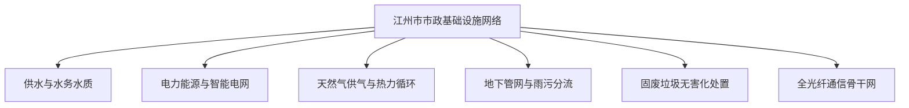

# 虚拟城市·江州市档案：01_基础设施

> **维度定位**：城市生命线与承载底座  
> **核心指标**：水、电、气、排污、综合管廊、环卫固废与通信骨干网  
> **叙事关联**：教工与品质小区生活品质保障、2020疫情封闭期水电气生命线、沈振邦工业园区配套支撑。

---

## 一、 基础设施规划概况

江州市作为华东经济重镇与区域副中心城市，基础设施建设兼顾高标准现代中产居住需求与先进制造产业承载力。城市在“十三五”至“十五五”期间全面推行地下综合管廊与智慧公用事业改造，保障城市在极端气候与应急状态下的极端韧性。

---

## 二、 六大核心公用事业系统

### 1. 供水与水质净化系统
* **水源布局**：采用“双水源”互补保障格局。主水源为**江州水库（国家Ⅰ类饮用水源保护区）**，应急备用水源为江州北段清江深层取水工程。
* **水厂配置**：全域建有4座大型现代化自来水厂，日供水能力达到 **220万立方米**；全面应用深度水处理工艺（臭氧+生物活性炭吸附）。
* **末端直饮与水质**：在江州理工大学教工小区、文萃苑等核心生活区推行管网二次供水智能化改造，末端水质在线监测合格率达99.98%，出厂水质优于国家生活饮用水卫生标准。

### 2. 电力与特高压受电系统
* **外电入江与本地电源**：依托“白鹤滩—江苏/浙江”特高压交流环网江州变电枢纽，实现清洁水电大规模受入；本地布局热电联产电厂与沿江分布式屋顶光伏。
* **电网韧性与自动化**：全城供电可靠率达 **99.992%**（用户年平均停电时间低于45分钟）。
* **工业与民生双轨**：
  * **江州汽车工业园（沈振邦汽配工厂所在地）**：配备双回路专线供电与微电网应急柴发，确保精密模具加工毫秒级不掉电；
  * **学区与文教区（陆家与沈家居住区）**：全电缆入地，配置自动化自愈配电箱，保障极端天气下居家网课与科研平稳。

### 3. 管道天然气与能源清洁化
* **气源骨干**：接入西气东输三线江州分输站与沿海LNG接收站管网。
* **供气覆盖**：城市核心区管道燃气通达率 **100%**，年供气量超 **18亿立方米**。
* **智慧燃气安全**：中产住宅区（如文萃苑）全面强制安装物联网远程切断阀与红外泄漏报警探头，直接与市燃气集团调度中心联网。

### 4. 排水排污与地下综合管廊
* **雨污分流改造**：2018—2021年全市完成老旧小区与主次干道雨污分流改造工程，主城区实现截污纳管率达 **98.5%**。
* **污水处理设施**：建有6座全地下式生态污水处理厂（日处理能力160万吨），出水指标达到地表准Ⅳ类水标准，尾水用于城市生态补水。
* **地下综合管廊示范区**：在大学城高教区、高新软件谷及沿江新城建有总长 **68公里** 的地下综合管廊，水、电、气、通信、雨水集约入廊，彻底根绝“马路拉链”现象。

### 5. 垃圾分类与固废无害化处置
* **四分类智慧系统**：2019年江州市全面立法推行生活垃圾强制分类，中产小区推行定时定点“AI人脸识别+破袋称重”智能垃圾房。
* **终端处理循环**：建设江州东郊循环经济产业园，建有日焚烧发电能力4000吨的环保电厂与餐厨垃圾厌氧产沼项目，生活垃圾“零填埋”与资源化利用率超 **85%**。

### 6. 通信基础设施与光纤入户
* **千兆光网全覆盖**：全域光纤宽带到户率100%，家庭千兆接入普及率居全省首位。
* **多网协同通信**：建设全城一体化多业务传送网（OTN），为政务协同、高校科研专网（温静姝实验室与国家超算中心专线）提供T级带宽保障。

---

## 三、 时代大事件中的基础设施压力测试

| 历史时期 | 基础设施考验场景 | 江州市系统应对与叙事切片 |
| :--- | :--- | :--- |
| **2019 国庆前夕** | 全网隐患大排查与保供 | 市政开展水电气“拉网式”安全巡检，杜绝一切盲区，陆明远在小区物业参与普法监督。 |
| **2020 疫情封闭期** | 全封闭下无间断民生保供 | 水电气全面推行“欠费不停供、远程云充值”；温静姝高校网课、林知微上市公司财务结算均依托超高带宽专网零卡顿运行。 |
| **2021 极端暴雨季** | 城市地下排水防涝测试 | 汲取郑州特大暴雨教训，江州提前对清江防洪堤、地下管廊与下沉立交安装抽水泵组与水浸预警传感器，平稳度过汛期。 |
| **2024—2026 新质期** | 高算力数据中心电力配套 | 为承接AI大模型训练与高科技企业算力需求，城北软件园扩建220kV专用智能变电站。 |
