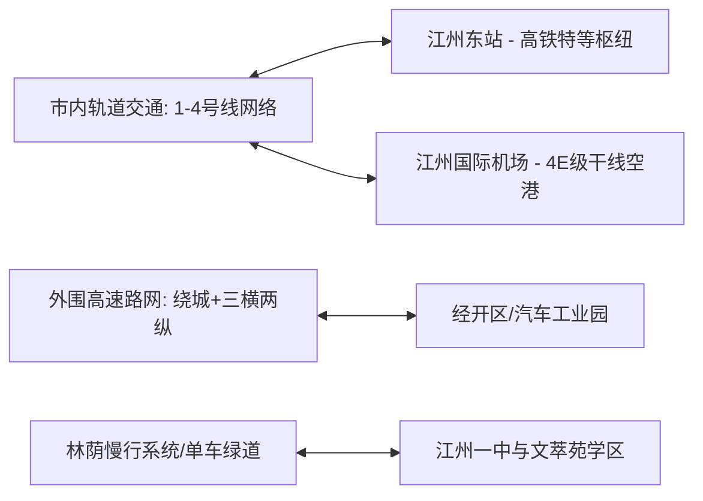

# 虚拟城市·江州市档案：02_交通运输

> **维度定位**：城市时空骨架与内外互联  
> **核心指标**：高铁枢纽、空港网络、高速路网、城市轨道交通与微循环慢行系统  
> **叙事关联**：沈策与陆令仪的山地单车骑行动线、沪江城际（闻芷沪上往返）、两家父母的日常通勤。

---

## 一、 综合交通枢纽架构

江州市地处沿海经济走廊与长江黄金水道交汇辐射带，是国家综合立体交通网的重要枢纽节点。

---

## 二、 核心交通支撑板块

### 1. 轨道与铁路枢纽体系
* **江州东站（特等综合客运枢纽）**：
  * 京沪高铁辅助通道与沿江高铁枢纽站，站房规模10台22线；
  * **沪江城际高频专线**：**江州 $\leftrightarrow$ 上海虹桥仅需48分钟**，实现公交化运营（早晚高峰每15分钟一趟），这构成了闻芷父母往返沪上商贸、闻芷周末往返长三角艺术展的超便捷通道。
* **江州老站（普速与市域通勤）**：承接省内普速货运及市域S1线始发。

### 2. 民用航空与对外空域连接
* **江州国际机场（4E级民航干线空港）**：
  * 拥有2条3600米远距离平行跑道，年旅客吞吐能力超过 **2500万人次**；
  * 开通直飞东京、首尔、新加坡、法兰克福等国际客货运航线；
  * 地铁3号线直达航站楼地下一层，市内主要文教区40分钟直达。

### 3. 高速公路网与货运物流通道
* **“一环四射”高速路网**：
  * 江州绕城高速连接G2京沪、G42沪蓉高速支线；
  * **产业货运走廊**：设专用货运快速路直连**江州汽车工业园（沈振邦汽配工厂）**与沿江深水港区，重载货车完全绕开主城文教区。

### 4. 市区轨道交通（江州地铁）
* **运营线网（至2022年开通4条主干线，总里程162公里）**：
  * **地铁1号线（南北脊梁线）**：连接江州老城区、市行政中心与沿江CBD；
  * **地铁2号线（东西发展轴）**：穿过高新软件谷（林知微科技公司）与江州东站；
  * **地铁3号线（科教文旅线）**：途径**江州理工大学站**、**江州一中站**，并在**文萃苑站**设立出入口，是主城区客流强度最高的人文骨干线；
  * **地铁4号线（环线）**：实现外围换乘分流。

### 5. 地面微循环与中产慢行空间（重点场景）
* **文教区慢行林荫道（核心叙事场景）**：
  * 从江州理工大学教工家属区（文萃苑）至江州一中南门，全长约 **2.8公里**；
  * 沿途覆盖香樟林荫与专用非机动车道，设有独立的单车电子绿波带。
  * **沈策与陆令仪的日常动线**：
    * 沈策的山地车永远骑行在外侧车道（靠机动车隔离带一侧），陆令仪骑行在靠人行道内侧；
    * 沈策通过推算红绿灯配时（平均单程耗时8分20秒），将放学骑行时间精确卡死，杜绝任何外人并排骑车的可能。

---

## 三、 交通与时代事件的互动记录

| 关键时间点 | 交通场景事件 | 城市运转与人物轨迹 |
| :--- | :--- | :--- |
| **2019年9月** | 初一创新班开学通勤 | 闻芷随家庭自沪上转至江州，依托城际高铁每周往返长三角；沈策开始执行为期数年的单车全天候接送陆令仪任务。 |
| **2020年1—3月** | 疫情防控交通卡口封闭 | 机场高铁客流骤减，地铁缩减班次；沈振邦持汽配保供企业专用通行证，驾驶私家车往返工厂车间。 |
| **2021年** | 地铁全网扫码与人脸乘车 | 全线支持健康码自动核验进站，温静姝团队算法参与客流动态疏导。 |
| **2023—2026年** | 充电桩普及与智慧绿波带 | 江州全面普及新能源专用号牌与公共超充桩，高校林荫道改造为全天候智慧骑行景观带。 |
