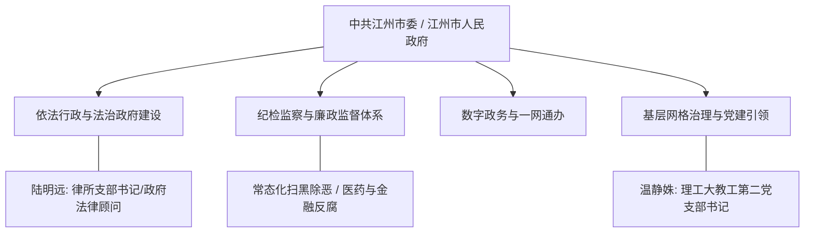

# 虚拟城市·江州市档案：03_政治治理

> **维度定位**：体制中枢与法治秩序  
> **核心指标**：依法行政、政务公开、反腐倡廉、基层党建与司法公正  
> **叙事关联**：陆明远（律所党支部书记）的法治信仰与家训、温静姝（高校支部书记）的基层组织、江州政法队伍教育整顿与扫黑除恶治理。

---

## 一、 政治治理架构与行政能级

江州市为副省级（或经济强地级市）建制，下辖4个中心城区、2个高新产业园区及2个代管县级市。城市治理秉承华东沿海地区“法治先导、精细治理、党建引领”的现代化治理模式。

---

## 二、 核心治理支柱与制度运行

### 1. 依法行政与法治政府示范市
* **法律顾问制度全覆盖**：
  * 江州市全面推行党政机关重大行政决策法定程序与合法性审查；
  * **陆明远所属律所**：作为江州市政府常年外聘法律顾问团成员，长期承担涉及民营企业改制、重大基建合同及行政诉讼答辩的法律合规论证，确保“每一项重大决策皆有法可依”。
* **政务公开与阳光行政**：
  * 市政府常务会议决策事项、财政预决算、民生工程清单实行100%线上实时公示，市民满意度长期保持在95%以上。

### 2. 纪检监察与穿透式反腐监督
* **合署办公效能**：
  * 2018年市监察委员会成立后，市纪委监委深入推进派驻监督全覆盖，重点紧盯国企改制、工程招投标、医药采购及政法司法关键少数；
* **重点治理战役在江州的推进**：
  * **2018—2020年扫黑除恶**：打掉盘踞在江州农贸批发、渣土运输领域的黑恶势力团伙，立案彻查公职人员违纪违法案件；
  * **2021年政法队伍教育整顿**：对江州政法干警开展刀刃向内整治，重点清理违规干预司法、违规减刑及经商办企业；
  * **2023年医药反腐**：全面清查市属三甲医院耗材试剂采购腐败，追回违规资金。

### 3. 党建引领与基层治理（微观切片）
* **“党建促所建”与职业道德红线**：
  * 陆明远作为律所党支部书记，每月主持支部“三会一课”，坚持以政治纪律严防法律寻租，在律所内部立下“不越法纪底线、不沾非法利益”的铁律，这种作风直接内化为陆家的严谨家训；
* **高校教工党支部示范堡垒**：
  * 温静姝担任江州理工大学计算机学院教工第二党支部书记，将党建与高水平科研攻关、师德师风建设紧密融合，在2020年抗疫与社区保供中充分发挥党员先锋队作用。

### 4. 公众参与与市民热线网络
* **“12345”市民服务热线智慧中枢**：
  * 实行“接诉即办、全流程闭环督办”；
  * 工单平均响应时间缩短至2小时内，按期办结率99.2%，成为市民监督公共服务效率的重要通道。

---

## 三、 时代变迁中的治理印记

| 年份阶段 | 治理重心与政策举措 | 时代印记与人物生活 |
| :--- | :--- | :--- |
| **2018—2019年** | 机构改革与基层“打伞破网” | 市应急管理局、医疗保障局挂牌；陆明远牵头处理涉案民企资产处置与债务重组，家庭谈话常涉法治规矩。 |
| **2020年** | 战疫网格化联防联控动员 | 实行市级统筹、街道包干、社区设岗；温静姝带头通宵值守社区党员先锋岗，陆明远组织律所党员提供公益法援。 |
| **2021年** | 常态化治理与政法队伍学习 | 全市政法与法学界全面展开自我排查，杜绝一切特权思维，促使大院与知识分子子弟在学业中纯靠实力公平竞争。 |
| **2024—2026年** | 营商法治化与全面从严治党 | 积极落实《民营经济促进法》，江州出台保护中小微企业合法权益条例；党的二十届五中全会后，持续完善全过程权力制约机制。 |
