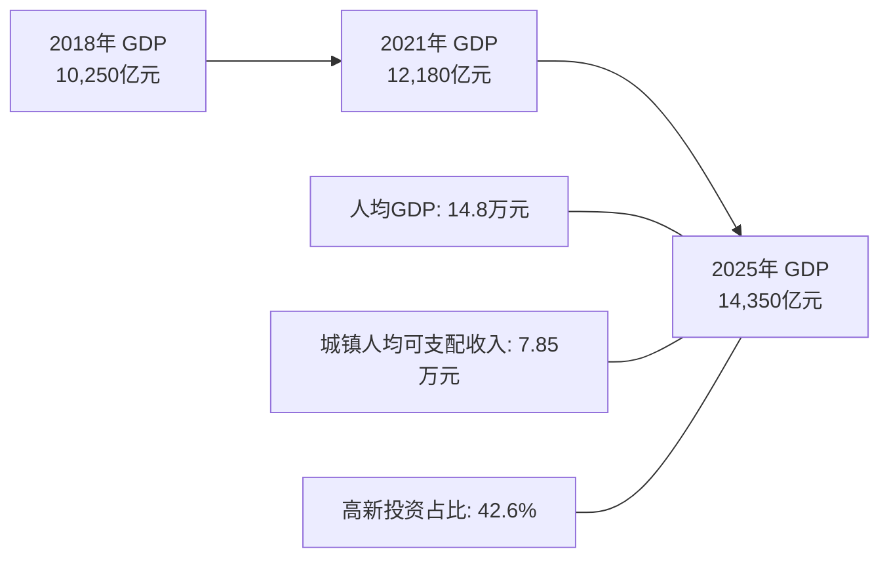

# 虚拟城市·江州市档案：04_经济发展

> **维度定位**：城市财富生成与物质繁荣基石  
> **核心指标**：GDP总量、人均产出、居民可支配收入、财政实力与投资活力  
> **叙事关联**：陆家（750万资产）、沈家（700万资产）的知识分子中产生活基底，闻家（1200-1500万）的沿海轻资产商贸底蕴，以及江州经济由旧动能向新质生产力的换挡。

---

## 一、 经济总量与发展位次

江州市属于我国东部沿海综合经济实力位居前列的强二线（或准新一线）名城，经济体量与人均财富位列全国前二十位。

---

## 二、 核心宏观经济指标（2018—2026年演变）

| 指标维度 | 2018年基准 | 2021年转折期 | 2025—2026年现状 | 经济社会意义 |
| :--- | :--- | :--- | :--- | :--- |
| **全市地区生产总值（GDP）** | 10,250 亿元 | 12,180 亿元 | 14,350 亿元 | 跨入“万亿GDP俱乐部”后稳健增长，抗风险韧性强。 |
| **一般公共预算收入** | 1,020 亿元 | 1,180 亿元 | 1,290 亿元 | 财政自给率达88%，有充裕财力投向民生教育与基建。 |
| **城镇常住居民人均可支配收入** | 5.86 万元 | 6.85 万元 | 7.85 万元 | “藏富于民”，形成庞大的高素质中产知识分子消费群体。 |
| **固定资产投资结构（高新 vs 地产）** | 地产投资占比 38% | 地产投资占比 26% | 高新技术制造业占比 44% | 成功完成投资动能转化，摆脱单纯土地财政依赖。 |

---

## 三、 阶层收入结构与家庭经济全景（叙事对标）

江州的经济生态培育了极具稳定性的中产阶级群体。小说中的三大家庭正是江州经济社会结构的生动微观缩影：

### 1. 中产知识分子双职工家庭（典型区间：500万～1000万）
* **陆家（法务与上市公司财务）**：
  * **陆明远**（专职民商事诉讼律师/合伙人）：年创收分成45万～65万；
  * **林知微**（科技上市公司CFO）：年薪与绩效35万～45万，持有股权激励；
  * **家庭净资产约750万**：江州优质学区房（文萃苑约400万），家用车2辆（约40万），其余为高流动性稳健理财与公积金；
* **沈家（实体工业制造与高校编制）**：
  * **沈振邦**（汽配骨干企业资深技术总监/高工）：年薪与项目奖金45万～55万；
  * **温静姝**（江州理工大学副教授/硕导）：年薪资与课题劳务25万～35万；
  * **家庭净资产约700万**：同单元自住房产（约380万），银行定存与大额存单比例极高，财务防御属性极强。

### 2. 沿海前卫商贸富裕家庭（区间：1200万～1500万）
* **闻家（外贸高管与品牌电商主理人）**：
  * 依托长三角一体化商业网络，父亲任职沪上外贸高管，母亲独立操盘全国知名设计师品牌网店；
  * 现金流充沛、资产配置开放全球化，赋予了闻芷超越中产传统的消费习惯与审美自由。

---

## 四、 时代周期对江州经济的考验

1. **2019年：外贸承压与实体升级**：
   * 遭遇中美关税冲击，江州外贸型企业加速内销转型，沈振邦所在汽配制造转向国内新能源头部车企配套，完成市场突围。
2. **2020年：疫情冲击下的深V反弹**：
   * 凭借发达的现代物流与工业自给能力，下半年规模以上工业增加值反弹至7.8%，林知微所在科技公司逆势完成云服务业务爆发。
3. **2021—2024年：房地产深度调整与理性着陆**：
   * 伴随恒大危机与全国楼市调整，江州二手房价格温和回落15%～20%，土地出让金缩减；
   * 地方政府果断将财政重心转向“产业基金引导”，利用6万亿化债政策置换隐性债务，全市经济未发生系统性金融风险。
4. **2025—2026年：新质生产力全面释放**：
   * 随着《民营经济促进法》施行与高技术制造业投资增长，工业软件、智能装备、AI大模型研发成为全市最具吸金能力的增长极。
