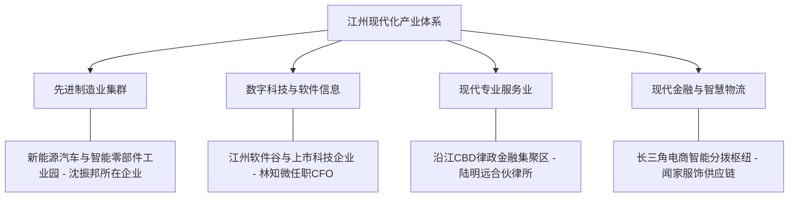

# 虚拟城市·江州市档案：05_产业体系

> **维度定位**：城市产业集群与实体经济骨架  
> **核心指标**：先进制造、软件与科技产业、现代专业服务业、金融资本与供应链物流  
> **叙事关联**：沈振邦（新能源汽车零部件制造龙头）、林知微（民营科技上市公司CFO）、陆明远（法律服务集群合伙人）、闻家（全国电商与外贸物流）。

---

## 一、 “4+3”现代化产业集群布局

江州市摒弃了早期粗放型低端代工模式，围绕“先进制造立市、数字科技强市、现代服务优市”战略，构建起深度协同的产业生态网络。

---

## 二、 四大核心产业支柱深度剖析

### 1. 先进制造业：新能源汽车与精密装备集群
* **产业基地**：**江州汽车工业与智能装备产业园（经开区）**。
* **产业链地位**：
  * 汇聚规上工业企业320余家，年产值突破 **2800亿元**；
  * **沈振邦所在企业**：作为国内顶级汽车零部件制造骨干企业，主攻新能源汽车轻量化车身模具、电驱动总成精密齿轮与高强度合金冲压件，直接为比亚迪、特斯拉长三角超级工厂及造车新势力供货；
  * **工艺突破**：2019—2020年一线攻关大型压铸精密模具与工业自动化流水线，打破德国日本技术垄断。

### 2. 科技与软件信息产业：数字高地与上市公司孵化
* **产业基地**：**江州高新软件谷（科技创新走廊）**。
* **业务图景**：
  * 重点发展工业软件、政务云平台、工业物联网与企业数智化解决方案；
  * **林知微任职的民营科技上市公司**：市值约60亿～80亿元，深耕金融大数据风险控制、企业高频量化财务核算及智能工业仿真软件；
  * **产学研一体化**：与温静姝所在的江州理工大学计算机学院建立博士后科研工作站，承接国家级前沿AI与自然语言处理科研成果转化。

### 3. 现代专业服务业：高端律政与财税审计
* **产业聚集区**：**江州金融城·律政产业园（沿江CBD）**。
* **服务能级**：
  * 集中了华东地区一流的中型诉讼律所、四大会计师事务所分所、专利代理机构及民商事仲裁中心；
  * **陆明远所属律所**：深耕民商事诉讼、企业破产重整与重大经济纠纷仲裁，年创收连续五年位列江州律界前五位，以严谨合规、拒绝灰色交易在行业内树立了“法治铁规”标杆。

### 4. 现代物流与数字时尚电商集群
* **产业辐射**：依托江州北港铁水联运枢纽与绕城高速智慧物流园。
* **全国极速达能力**：
  * 顺丰、京东物流华东二级枢纽设立于此，实现长三角次日达、全国48小时直达；
  * **闻芷母亲品牌网店的运营依托**：江州完善的供应链与面料采购直连网络，使得闻家的独立设计师品牌服饰能够以敏捷供应链模式实现“快速打版、即时预售、全国高效率分发”。

---

## 三、 产业体系与主角家庭的微观联动

| 家庭角色 | 所属产业细分 | 产业发展对家庭生活的现实塑造 |
| :--- | :--- | :--- |
| **沈振邦** | 先进制造·汽配高精模具 | 带来严苛的工艺公差思维与工厂纪律，沈振邦把车间一丝不苟的硬派标准移植为对沈策的作息与体格训练。 |
| **林知微** | 科技服务·上市公司CFO | 长期接触资本市场、高精算力与投融资风控，造就了其极度敏锐的概率思维与家庭资产审慎配置风格。 |
| **陆明远** | 专业服务·商事律所合伙人 | 律所常年参与企业破产与民间借贷案件，深刻目睹市场杠杆反噬的惨烈教训，强化了陆家绝不投机、重规守纪的家风。 |
| **温静姝** | 科技研发·高校硕导与科研骨干 | 将高校纯粹的理论算法、推演图谱与严密数理逻辑直接传导给沈策，造就了沈策“竞赛断层第一”的学术护城河。 |
