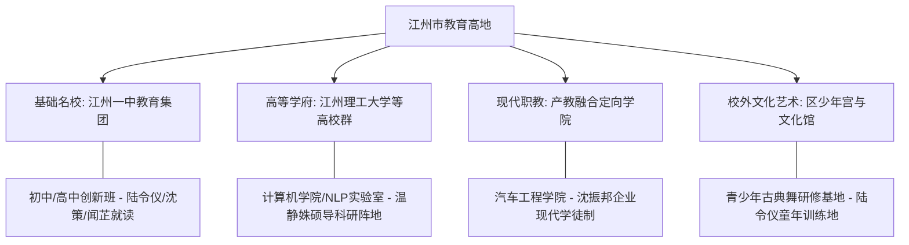

# 虚拟城市·江州市档案：06_教育体系

> **维度定位**：智力孵化与代际流动核心引擎  
> **核心指标**：顶尖名校、基础教育均衡化、高等院校科研矩阵与拔尖创新人才贯通培养  
> **叙事关联**：江州一中创新班（陆令仪/沈策/闻芷主舞台）、江州理工大学（温静姝任教）、双减政策冲击与奥赛题库资源争夺。

---

## 一、 教育资源梯次与全景图谱

江州市素有“崇文重教、院士之乡”的文化传统。全城构建了“名校集团化普及 + 拔尖创新人才早发现早培育 + 省属高水平大学策源”的现代化教育生态。

---

## 二、 核心教育载体深度解析

### 1. 江州一中：百年名校与创新实验班
* **学校定位**：全省首批重点中学、全国百强高中，江州精英教育的皇冠明珠。
* **理科创新班（核心叙事舞台）**：
  * **生源选拔**：全市初一年级仅特招2个创新班（每班约40人），全员具备数学奥赛省一、信息素养拔尖或极高数理综合赋能；
  * **教学特色**：采取“初高中一体化衔接教学”，初一即引入高中甚至大学预科数理逻辑，早早布局全国中学生数理化生信五大学科竞赛；
  * **班级生态**：
    * **班长沈策**：竞赛成绩断层第一，统揽班级自习秩序与题库；
    * **陆令仪**：以自律、法理逻辑与辩证思维位居综合第一梯队；
    * **闻芷**：沪上名校转学而来的审美破壁者。

### 2. 江州理工大学：工科强校与重点实验室
* **学府层级**：省属重点建设大学、卓越工程师培养高校。
* **计算机学院与自然语言处理实验室**：
  * **温静姝团队**：承担国家自然科学基金重点研发项目，专注于大规模文本语义理解、机器翻译与智能算法演进；
  * **教育资源外溢**：温静姝实验室的学术论文检索权限、高性能集群模拟题库，直接化为沈策私下整理辅导陆令仪的“独家科研武器”。

### 3. 区少年宫与文化艺术培养基地
* **艺术启蒙殿堂**：位于老城区林荫环绕的**江州市青少年文化艺术宫**。
* **陆令仪的体态之源**：
  * 陆令仪从5岁起至初中，常年在该馆接受少儿古典舞系统集训；
  * 师从省舞协资深形体名师，锤炼出其挺拔的天鹅颈、直角肩与背脊如竹的脱俗骨相，塑造了其外柔内刚的审美体格。

### 4. 产教融合与高素质技术技能人才
* **江州职业技术大学（全国双高计划）**：
  * 与沈振邦所在的汽车零部件龙头企业共建“新能源模具工程师学院”；
  * 推行现代学徒制，为制造车间源源不断输送掌握精密数控、工业机器人的金牌技工。

---

## 三、 时代政策对江州教育生态的重构

| 时代政策节点 | 政策落实举措 | 对小说人物与剧情博弈的催化 |
| :--- | :--- | :--- |
| **2019年秋** | 特招免试与创新班开班 | 闻芷凭借特长转入江州一中初一创新班，沈策（152 cm）与陆令仪（157.5 cm）形成前后桌与班级秩序核心。 |
| **2020年春** | 疫情全面线上网课推进 | 一中创新班依托智慧校园平台开展高强度线上推题，温静姝牵头全校网课标准，两家同单元共克学业难关。 |
| **2021年7月** | **“双减”政策雷霆落地** | 校外一切学科类培训机构周末补习被强力取缔。尖子生竞争完全回归“校内自习 + 家庭自学”。**沈策独家整理的全国名校高难度内部卷成为稀缺硬通货**，彻底切断陆令仪向外部求教的渠道。 |
| **2024—2025年** | 强基计划与拔尖自招深化 | 高校自招侧重人工智能交叉学科。沈策与陆令仪在全国奥赛冬令营中脱颖而出，直通清北顶尖拔尖创新试验班。 |
