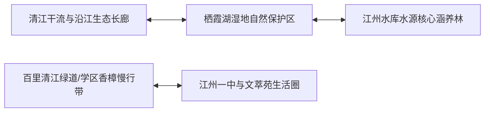

# 虚拟城市·江州市档案：08_生态环境

> **维度定位**：自然本底与绿色宜居品质  
> **核心指标**：空气优良率、地表水环境、林荫公园绿道系统、产业脱碳与山水格局  
> **叙事关联**：清江绿道与香樟林荫（沈策与陆令仪骑行风景）、栖霞湖湿地公园（闻芷与陆令仪散步漫谈）、城市低碳工业转型。

---

## 一、 “一江一湖两带”山水生态格局

江州市地处江南水网沃野，坐拥“城在水中、水在绿中、人在景中”的典型江南山水园林风貌。城市空间规划恪守生态红线，形成了山、水、林、田、湖、城有机融合的生命共同体。

---

## 二、 核心生态环境指标与治理体系

### 1. 大气环境质量与“江州蓝”
* **空气质量常年优良**：
  * 全市PM2.5年均浓度稳定控制在 **25微克/立方米以下**，空气质量优良天数比率超过 **91.5%**（每年超334天）；
  * 依托沿海海陆风循环与内陆湿地，主城区长年碧空如洗，成就了文萃苑教工小区阳台上清爽通透的晨光与晚霞。

### 2. 水环境治理与清江水系
* **地表水质全达标**：
  * 贯穿主城区的**清江**干流水质常年保持在 **Ⅱ类至Ⅲ类标准**；
  * 全面落实“河长制”，彻底取缔沿江所有化工散乱污码头，改建为连续贯通的 **30公里清江生态碧道**；
  * 饮用水源地江州水库水质达标率 **100%**。

### 3. 绿地系统与中产林荫慢行环境（重点场景）
* **“300米见绿、500米见园”**：全市建成区绿化覆盖率达 **43.8%**，人均公园绿地面积达到 **16.2平方米**。
* **经典叙事地标**：
  * **文萃苑香樟林荫道**：两旁栽种树龄超30年的高大香樟，夏季浓荫蔽日，微风中常带清凉樟脑清香；
  * **栖霞湖湿地公园**：闻芷经常在此邀陆令仪周末写生漫步，湖面水波如镜，荷花与芦苇荡摇曳，成为脱离题海压力、品味同性私密心声的静谧精神港湾。

### 4. 工业脱碳与“双碳”绿色示范
* **零碳车间改造（沈振邦企业践行）**：
  * 响应国家2020年提出的“双碳”战略，沈振邦所在的汽车零部件园区全面铺设屋顶分布式光伏，淘汰高耗能燃煤锅炉，引入工业废水循环近零排放装置；
  * 打造出国家级绿色制造工厂，彰显现代工业文明与生态保护的协同平衡。

---

## 三、 时代生态变迁与生活实感

| 阶段节点 | 生态环保事件 | 城市生活变化与叙事印记 |
| :--- | :--- | :--- |
| **2018—2019年** | 沿江大保护与散乱污清退 | 江州清江两岸拆除老旧砂石码头，改建为滨江马拉松公园与市民骑行绿道，沈策夜跑路线正式向滨江拓展。 |
| **2020年** | 双碳目标下的绿色低碳转型 | 市政在中小学与高校推行“无废校园”，陆令仪与沈策在创新班参与绿色节能调研课题。 |
| **2022—2024年** | 海绵城市建设平稳度过汛期 | 城市地下透水铺装与蓄水池有效化解梅雨季积水，文萃苑与一中校道雨后迅速收水干爽，无积水溅湿校服。 |
| **2025—2026年** | 生态空间与美育融合 | 栖霞湖引入现代雕塑艺术季，闻芷的母亲担任艺术顾问，闻芷带陆令仪领略自然生态与现代现代主义美学的交响。 |
