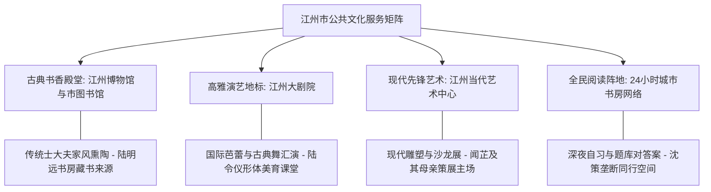

# 虚拟城市·江州市档案：09_文化建设

> **维度定位**：城市精神风骨与审美引力场  
> **核心指标**：公共文博场馆、大剧院演艺、当代艺术产业、文化遗产传承与书香风尚  
> **叙事关联**：江州大剧院（陆令仪古典舞与芭蕾观摩）、当代艺术中心（闻芷带陆令仪审美启蒙）、市图书馆24小时书房（沈策题库自习争夺）。

---

## 一、 “古今交融”的人文地理基质

江州市承载千年吴越江南文脉，兼收近代开埠工商业文明与沿海现代主义前沿思潮。全城形成了以“传统书香典雅”为底色、以“国际高雅艺术与青年潮流文化”为两翼的文化繁荣格局。

---

## 二、 核心文化载体与叙事交汇点

### 1. 江州大剧院（高雅演艺与古典舞殿堂）
* **建筑风貌**：坐落于清江之畔，外形如同一片轻舒的荷叶浮于江面，拥有1800座歌剧厅与800座音乐厅。
* **陆令仪的审美圣殿**：
  * 中央芭蕾舞团、马林斯基剧院芭蕾舞团长三角巡演的必到站；
  * 林知微定期携陆令仪在此观摩《天鹅湖》、《红色娘子军》及《只此青绿》等顶尖剧目，造就了陆令仪极高的艺术鉴赏力和自幼自律挺拔的舞者风范。

### 2. 江州当代艺术中心（MOCA Jiangzhou）
* **艺术高度**：由原江州老工业机床厂改造而成的沿海先锋艺术空间。
* **闻芷的高维审美主场（关键情节线）**：
  * 闻芷的母亲作为知名国际艺术策展人，长年在此策划当代摄影、现代前卫艺术与青年审美沙龙；
  * 闻芷经常在周末借探讨艺术之名，带陆令仪避开中产小区的传统说教，在昏暗而极具张力的艺术展厅中，向其引荐打破传统禁锢的现代主义雕塑与唯美情感文学，完成对陆令仪精神与性观念的心灵启蒙。

### 3. 江州博物馆与地方金石文脉
* **馆藏能级**：国家一级博物馆，馆藏青瓷、明清文人书画及近现代商帮档案数万件。
* **家风渊源**：陆明远工作之余常带女儿参观历代法帖与律令刻石，以“明德慎罚、端正行仪”训导女儿，使陆令仪自幼对规矩纪律与古典文学怀抱敬畏。

### 4. 市图书馆与24小时“江州书房”网络
* **全民阅读覆盖**：全市建有12座区级图书馆与超100处社区24小时自助书房。
* **沈策的“自习空间围剿”**：
  * 文萃苑社区书房内，沈策凭借班长职务与早到习惯，永远在靠窗阳光最好的双人阅读位上预留两个位置（一人属于自己，一人属于陆令仪）；
  * 桌面上整齐码放的不是畅销书，而是高阶竞赛题卷与温水杯，将自习空间打造成两人闭合的学霸气泡。

---

## 三、 时代文化思潮在江州的激荡

| 历史时期 | 城市文化事件与思潮 | 人物心智碰撞与叙事投射 |
| :--- | :--- | :--- |
| **2019年** | 国庆70周年红色文化展与996反思 | 全市掀起爱国主旋律热潮；高校与文艺界在书店举办“技术异化与劳动尊严”研讨，沈策与陆令仪在周记中探讨辩证法。 |
| **2021年** | 建党百年大型交响诗会与传统复兴 | “国潮”与传统舞蹈风靡全网，陆令仪在学校艺术节领舞古典舞独舞《折柳》，清冷出尘的风姿轰动全校。 |
| **2023年** | 前卫情感文学与跨界艺术热潮 | 唯美同性题材与先锋情感小说在青年圈层流传；闻芷将精选原版书借阅给陆令仪，以潜移默化的方式改变其性观念与亲密认知。 |
| **2025—2026年** | 数字艺术与AI生成影像大展 | 当代艺术中心推出AI大模型与人类艺术家联展，温静姝算法团队受邀为交互展品提供算力支持，科技与人文深度对话。 |
