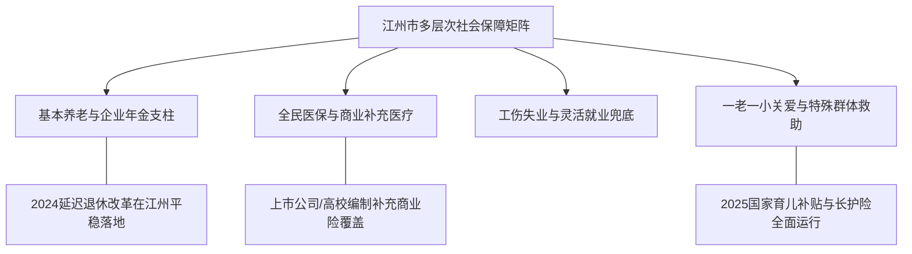

# 虚拟城市·江州市档案：10_社会保障

> **维度定位**：社会托底安全网与民生韧性底线  
> **核心指标**：五险一金全覆盖、养老兜底、补充医疗救助、延迟退休平稳衔接与育儿津贴落地  
> **叙事关联**：中产家庭的职业安全感与代际养老测算、2024延迟退休落地、2025育儿补贴在江州的兑现。

---

## 一、 社会保障覆盖总体框架

江州市社会保障体系综合发展水平稳居全省首位，建成了“广覆盖、保基本、多层次、可持续”的现代社会保障网。

---

## 二、 核心保障系统运行实态

### 1. 养老保障与“三支柱”支撑
* **基本养老保险**：城镇职工基本养老保险与城乡居民养老保险参保率达 **98.6%**，企业退休人员月均基本养老金居沿海高位。
* **中产知识分子的第二/第三支柱（对标父母生活）**：
  * **温静姝**享受高校事业单位职业年金与高知退休保障；
  * **林知微**所在上市公司为中高管统筹配置高额企业年金与个人养老金递延纳税商业险；
  * **陆明远**作为合伙人，在律所规范设立合伙人互助金与高额商业年金储备，家庭养老抗风险极高。

### 2. 医疗保障与长期护理保险（长护险）
* **医保结算“秒报销”**：全城开通医保电子凭证全场景刷码结算，与沪浙地区实现异地就医直接结算零门槛（便利闻家沪江往返医疗）。
* **第六险（长护险）示范**：全面推行长期护理保险制度，重点保障失能失智老人的机构与居家照护，大幅减轻独生子女中产家庭的照护焦虑。

### 3. 就业失业防线与兜底救助
* **稳岗返还机制**：在2020年疫情与2023年经济转型期间，累计向沈振邦所在汽配制造及林知微所在软件科技等企业返还失业保险稳岗资金数亿元，牢牢守住就业底线。
* **低保与临时社会救助**：城乡低保标准实现一体化，确保困难群众应保尽保。

### 4. 儿童福利与残障友好型社会
* **困境儿童关爱体系**：建立区、街、居三级儿童主任关爱网络；
* **普惠托育建设**：积极推进托幼一体化建设，文萃苑等中产社区均配备普惠性托育点，有效缓解青年育儿顾虑。

---

## 三、 时代社保改革在江州的微观投射

| 改革节点 | 政策与法规落地 | 中产父母的应对与家庭叙事切片 |
| :--- | :--- | :--- |
| **2021年** | 三孩政策配套支持意见 | 市社保局延长女职工产假并设立育儿假；林知微在公司工会推行母婴关爱室建设。 |
| **2024年9月** | **渐进式延迟法定退休年龄** | 陆明远（48岁）与沈振邦（49岁）在家庭聚餐时认真用人社部计算器测算各自的延迟退休时间（男职工延至63岁）。工科出身的沈振邦笑称“工程师越老越值钱”，陆明远则借此向儿女阐述人口老龄化背景下国家社保基金精算平衡的法理逻辑。 |
| **2025年** | **国家育儿补贴全面发放** | 落实3岁以下儿童每人每年3600元基准补贴，江州市财政叠加本地托育消费券，成为全社会生育支持的标志性暖心节点。 |
| **2026年** | 适老化社会保障立法评估 | 江州市出台全国首个市级《老龄友好型社区建设条例》，文萃苑加装智能呼叫报警器与无障碍电梯，体现高度民生温度。 |
