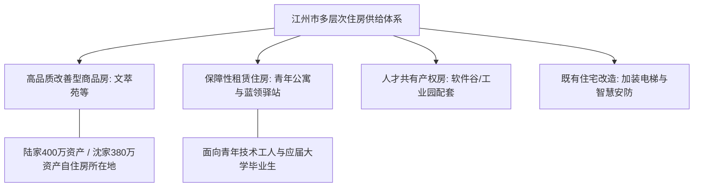

# 虚拟城市·江州市档案：11_住房保障

> **维度定位**：人居空间、资产蓄水池与安居工程  
> **核心指标**：多层次住房供给、保租房与人才房、中产改善型品质小区、物业安全与配套生态  
> **叙事关联**：文萃苑（两家同住的品质教工与商品房混合小区，同单元对门）、2021后房产去杠杆与林知微提前还贷决策。

---

## 一、 “租购并举”多层次住房供给格局

江州市率先落实国家房地产新发展模式，形成了“保障房保基本、商品房满足多样化改善需求”的多层次、多梯级住房供给体系。

---

## 二、 核心居住载体：文萃苑住宅小区（核心叙事主场景）

作为小说中两家生活、成长与博弈的核心主场景，文萃苑的物理与人文生态是典型的江州高知中产缩影：

### 1. 小区规划与物理参数
* **地理位置**：紧邻江州理工大学西门，步行至江州一中约15分钟，骑车8分钟。
* **建筑形态**：低密板楼小高层（11层电梯洋房），外立面采用典雅的干挂石材与米色真石漆，绿化率超40%，林木掩映。
* **户型格局**：
  * **陆家与沈家户型**：同单元同层，一梯两户，对门而居；
  * **套内面积**：建面约145平方米，四室两厅两卫；
  * **资产对标**：2019年市场评估均价约2.6万～2.8万元/平方米，总价约 **380万～400万元**，是两家资产负债表中最核心的沉淀资产。

### 2. 人文环境与邻里生态
* **高知中产聚集圈**：
  * 住户大多为江州理工大学教授、骨干教师、市属三甲医院医生、律所合伙人及汽配企业资深工程师；
  * 邻里之间知根知底，极重家风声誉、教育水准与礼貌规矩，彼此形成了极高的社会资本信任，也无形中构成了陆令仪与沈策少年时代的“道德防线高压区”。

### 3. 自行车棚与楼道空间（微观情感场景）
* **地下与地面单车停靠棚**：沈策每日上学前在此检查山地单车刹车与胎压，等候陆令仪下楼；
* **门对门的穿堂与阳台**：两家厨房与北阳台隔着天井微距相望，晚餐时的油烟香气与切菜声互通，2020年抗疫期间的物资互助与隔空喊话皆发生于此。

---

## 三、 保障性住房与租房市场监管

1. **产业园区配套保障性租赁住房**：
   * 在江州汽车工业园（沈振邦企业旁）和高新软件谷（林知微企业旁），政府主导兴建了2.5万套“拎包入住”的青年保租房，租金低于同地段市场价20%，有力吸纳外来青年人才。
2. **长租公寓租金监管**：
   * 2020年出台长租公寓资金监管办法，杜绝高进低出、长收短付的金融化跑路风险，维护青年租客合法权益。

---

## 四、 时代地产周期在江州的真实回响

| 历史时期 | 房地产市场脉动 | 家庭财务决策与心理冲击 |
| :--- | :--- | :--- |
| **2018—2019年** | 严格限购限售与楼市平稳 | 文萃苑二手房因顶尖学区属性价格坚挺，林知微完成尾款按揭平稳还款。 |
| **2021年** | 恒大暴雷与去杠杆潮涌 | 全国楼市信仰动摇，江州外围新盘出现降价打折。林知微凭借上市公司CFO的敏锐直觉，召开家庭会议，毅然决定动用部分理财**提前结清了文萃苑剩余的80万元房贷**，实现了家庭资产“零负债安全着陆”。 |
| **2024年** | “517新政”与存量房贷下调 | 江州全面取消限购限售，商业贷款利率降至历史低点；中产家庭普遍理性看待房产价值，房产回归纯粹的居住属性。 |
| **2025—2026年** | 房产止跌回稳与品质改造 | 文萃苑列入全省首批“好房子”数字化样板社区，完成地下管网清洗、全楼道智慧消防与充电桩进地下车库。 |
