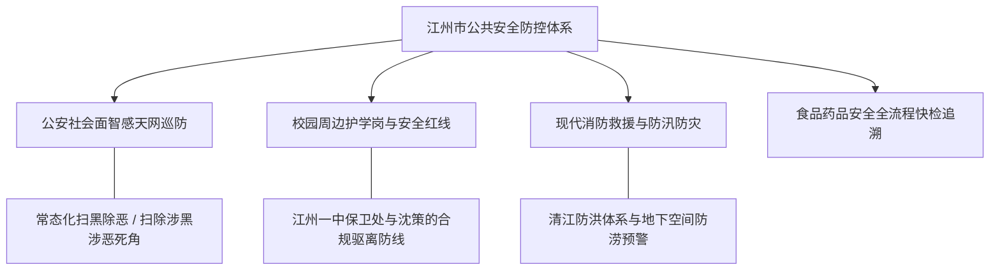

# 虚拟城市·江州市档案：12_公共安全

> **维度定位**：城市秩序盾牌与灾害风险防御中枢  
> **核心指标**：治安防控、智慧安防天网、校园周边安全、食品安全溯源与现代应急救援  
> **叙事关联**：沈策利用校园合规纪律与保卫处驱离外围男生（赵航事件）、高知小区的极高治安水准、全城防洪抗灾演练。

---

## 一、 平安江州：立体化公共安全防控矩阵

江州市连续三届蝉联“全国社会治安综合治理优秀市（长安杯）”，建立起“党政同责、部门协同、智慧天网支撑、公众参与”的现代公共安全治理体系。

---

## 二、 核心安全板块深度剖析

### 1. 治安防控网络与智慧天网系统
* **雪亮工程与全域监控**：
  * 全市主要干道、文教区、开放式绿道实现高清AI摄像机100%全覆盖；
  * 具备毫秒级人脸特征识别、轨迹推演与异常行为报警能力；
* **极低发案率与治安口碑**：
  * 严重暴力犯罪案件破案率达 **100%**，常年实现命案必破；
  * 高校教工区与一中周边夜间见警率极高，女学生夜间自习归家享有极高的步行安全感。

### 2. 校园与学区安全屏障（核心情节机制）
* **“护学岗”硬核防线**：
  * 江州一中校门口常年驻守公安交警铁骑与专职校园保安队，设立一键式紧急报警装置与防冲撞升降柱；
* **沈策的“合规执法借势”策略（关键案例）**：
  * **驱逐赵航（初三学长拦截事件）**：
    * 沈策面对试图在车棚骚扰陆令仪的学长，完全不动用私斗，而是暗中调取校门口监控视角死角、记录赵航私自翻越体育馆围栏与违规携带非教学电子设备的证据链；
    * 沈策直接以班长名义向学校保卫科与德育处实名提交报告，借由学校校规与公安派驻民警联合清查，将赵航定点处分驱离，彰显出冷静恐怖的系统性防御力。

### 3. 食品药品安全：阳光餐桌与全链条可追溯
* **校园食堂明厨亮灶**：
  * 江州一中食堂后厨全面推行“互联网+明厨亮灶”，食材采购实行“双人验收、农残速测、全流程扫码溯源”；
* **家庭饮食安全（林知微的标准）**：
  * 文萃苑社区配套的生鲜精品超市直采绿色有机农产品，林知微严格按照食品营养与食品法典为陆令仪搭配高蛋白减脂晚餐，支撑其古典舞身形雕琢。

### 4. 城市应急救援与防汛防台韧性
* **专业救援力量**：
  * 设有市综合应急救援支队（国家水域救援江州大队），配备大功率排涝车、水下声呐与热成像搜救无人机；
* **吸取历史教训的防涝升级**：
  * 2021年河南郑州特大暴雨后，江州市全面对主城区38座下穿立交桥、地下车库安装“智能水位标尺与自动落闸道闸”，彻底消除极端暴雨倒灌盲区。

---

## 三、 时代大事件中的安全防线运转

| 历史时期 | 安全防范重点 | 城市保障与微观生活实感 |
| :--- | :--- | :--- |
| **2018—2020年** | 扫黑除恶专项斗争清障 | 捣毁涉足江州菜市场摊位霸占与工程运输的涉恶团伙，文教区与沿江周边治安环境达到历史最优水平。 |
| **2021年汛期** | 极端强降雨防汛压力测试 | 遭遇“烟花”强台风侵袭，清江水位暴涨，江州应急指挥部提前预警，学校有序转为线上，无一人伤亡。 |
| **2022年** | 女性安全舆论期的高规格巡防 | 丰县、唐山事件爆发后，江州市公安局开展夏季夜巡专项行动，一中与高校周边晚自习沿线警灯长明，沈策在此期间更严密地执行单车贴身护送。 |
| **2023—2026年** | 反电诈纵深与网络AI换脸安防 | 公安局设立反诈预警唤醒中心，对电信诈骗涉案账户实施秒级止付，筑牢市民家庭钱袋子防火墙。 |
