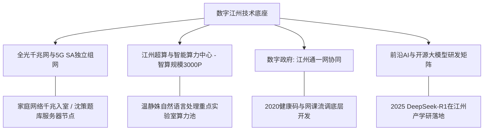

# 虚拟城市·江州市档案：13_数字建设

> **维度定位**：数字底座、智慧中枢与算力策源地  
> **核心指标**：5G网络全覆盖、算力中心、数字政务“一网统管”、工业互联网与前沿AI大模型落地  
> **叙事关联**：温静姝（计算机博导/NLP重点研发、健康码算法）、林知微（科技上市公司高精算力）、沈策（利用代码爬取与算法题库建构知识护城河）。

---

## 一、 数字江州：新型数字基础设施蓝图

江州市是国家“东数西算”东部枢纽节点重点协同城市、全省首个“双千兆”城市全覆盖标杆。以算力基础设施、大数据算法与产业互联网为三驾马车，构筑了高维智慧城市运转中枢。

---

## 二、 核心数字化载体与技术能力

### 1. 宽带网络与移动通信覆盖
* **5G基站密集布局**：
  * 2019年率先实现5G商用，至2022年全市累计建成5G宏基站超 **2.4万个**，实现主城区、产业园区、高校校园室外深度覆盖与室内微蜂窝盲区消除；
  * 文萃苑社区与江州一中实现WiFi 6与5G无缝切换。

### 2. 江州人工智能计算中心（昇腾与国产算力池）
* **算力能级**：规划算力规模达 **3000 PFLOPS（FP16）**；
* **温静姝团队的算力阵地（关键情节线）**：
  * 温静姝作为国家重点研发课题负责人，长期拥有该中心专用的高优先级超算机时；
  * **沈策的技术特权**：沈策早在初中阶段就获得母亲实验室的学生测试账号，利用母亲的超算集群写爬虫脚本自动抓取并去重全国30所顶尖竞赛名校的周练试卷，经过NLP模型自动分类标引，生成了碾压全班的绝密题库。

### 3. “江州通”数字政务与智慧交通
* **一网通办与一网统管**：
  * 99%以上政务服务事项实现“零跑动”在线秒批；
* **智慧交通绿波系统**：
  * 全市部署自适应交通信号机，通过地磁线圈与视频AI流实时调配路口红绿灯；
  * 沈策对一中往返文萃苑的这套绿波逻辑了如指掌，单车骑行时总能精准把握每一个路口的放行节奏。

### 4. 数据安全与个人信息保护堡垒
* **严格落实《个人信息保护法》**：
  * 2021年后，江州大数据局全面取缔任何违规抓取市民人脸与隐私数据的非合规APP，保障中产家庭在高度数字化生活下的信息安全。

---

## 三、 时代数字化事件在江州的具象展开

| 历史时期 | 数字化建设大事件 | 城市生活与小说角色联动 |
| :--- | :--- | :--- |
| **2019年** | 5G商用牌照发放与基站开工 | 江州一中试点智慧智慧教室，陆令仪在数字化黑板上展示辩证法思维导图。 |
| **2020年春** | **全城“健康码”极速研发** | 疫情暴发初期，温静姝教授率领青年教师与研究生团队进驻市大数据中心，紧急编写接触者时空伴随碰撞算法，支撑全省健康码稳定上线。 |
| **2023年** | 国家数据局挂牌与江州数据局设立 | 林知微所在上市公司参与制定工业数据要素确权国家标准，企业数字化估值跃升。 |
| **2025年1月** | **DeepSeek-R1大模型全球震撼** | DeepSeek开源模型发布当周，温静姝实验室连夜完成本地化集群私有化部署。沈策迅速将其作为数理猜想辅助证明工具，陆令仪惊叹于AI逻辑的自洽，两人的博弈维度正式跃入“人智协作”时代。 |
