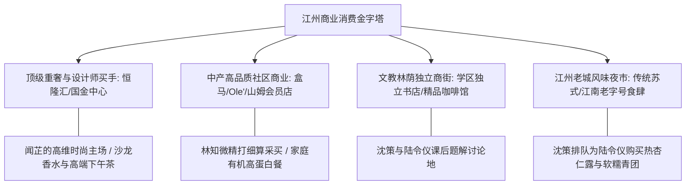

# 虚拟城市·江州市档案：14_商业消费

> **维度定位**：城市烟火气、消费层级与时尚潮流引力场  
> **核心指标**：高端重奢商业体、中产社区精品商业、便利店矩阵、夜间经济与前沿网购物流  
> **叙事关联**：恒隆汇与先锋买手店（闻芷带陆令仪审美破圈）、盒马与中产精品超市（林知微精算日常）、沈策私下投喂的江南老字号温软甜点。

---

## 一、 “金字塔型”多层级商业网络

江州市作为华东重要消费中心城市，构建了“国际顶级商圈领衔、中产社区商业紧密环绕、文教特色小店点缀、夜间烟火气融合”的多元消费生态。

---

## 二、 核心商业地标与生活切片

### 1. 江州恒隆汇（高端时尚与国际美学地标）
* **商业能级**：城市重奢地标，汇聚全球一线奢侈品牌旗舰店、顶尖小众独立设计师买手店与高端艺术餐厅。
* **闻芷的生活主场（关键情节线）**：
  * 闻芷转学至江州后，经常凭其母亲的VIP礼遇带陆令仪光顾位于顶层的私人会员沙龙；
  * **橙花与白檀香氛之源**：闻芷赠予陆令仪的第一瓶高端定制冷调沙龙香水即出自此处的法国调香工坊；
  * 在这里，闻芷用脱离传统中产做题家视野的松弛感与优雅品位，对陆令仪施展着降维审美熏陶。

### 2. 文萃苑“15分钟高品质生活圈”
* **生鲜与有机品质**：
  * 小区北门配有精品生鲜超市（盒马鲜生）与进口超市；
  * **林知微的采购艺术**：作为上市公司CFO，林知微精算家庭每一笔开支，既杜绝奢靡浪费，又严格选购最高品质的低脂牛肉、三文鱼与新鲜羽衣甘蓝，以科学配餐呵护陆令仪的古典舞体态。

### 3. 一中校门外的文教小资生态
* **咖啡馆与独立书房**：
  * 沿江州一中东门林荫路分布着数家氛围安静的独立手冲咖啡馆与文具集合店；
  * 沈策偶尔会在这类咖啡馆最安静的拐角桌旁，静默地为陆令仪拉开座椅，递上提前温好的脱脂奶，展开两本厚厚的全国奥赛真题。

### 4. 江南传统老街与夜市烟火
* **承载传统温情的地带**：
  * 位于老城水巷旁的“三里河老街”，保留了百年江南传统小吃；
  * 沈策经常在深秋和寒冬的傍晚，冒着冷雨骑车穿过几条街，排队买来刚出锅的温热纸包杏仁露和手作糯米红豆糕，用保温暖筒装着递到陆令仪手中，以无声的体贴软化“长姐”的心防。

---

## 三、 时代消费浪潮在江州的演进

| 历史时期 | 消费模式与趋势 | 时代印记与家庭账本 |
| :--- | :--- | :--- |
| **2019年** | 消费升级与网红打卡热潮 | 短视频带货崛起，闻芷母亲的品牌网店创下单场破千万元的销售纪录；城市年轻一代追逐精品手冲与小众沙龙。 |
| **2020年** | 社区生鲜配送与到家经济 | 封城期间，江州无接触配送与社区团购挑起大梁，林知微在线上精准秒杀平价新鲜蔬果与优质肉蛋。 |
| **2021—2023年** | **中产消费理性回归（务实求真）** | 经历地产调整与青年就业压力，中产家庭普遍收敛非必要奢侈消费，追求“性价比与确定性”；林知微家庭账本将非必要支出压缩，专注在子女核心教育与健康保障。 |
| **2024—2026年** | “两新”政策激发消费与国潮复兴 | 江州大力实施汽车、家电“以旧换新”，沈振邦换购了一辆本地制造的新能源SUV；市民消费更加青睐文化自信与高科技智慧生活。 |
