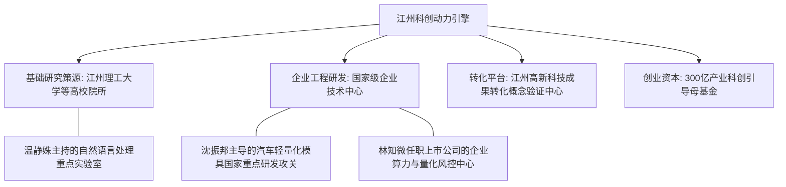

# 虚拟城市·江州市档案：15_科技创新

> **维度定位**：城市第一动力与智力高地  
> **核心指标**：高新技术企业体量、R&D经费投入强度、高校产学研协同、高精尖研发中心与成果转化机制  
> **叙事关联**：温静姝（NLP与大数据前沿实验室）、沈振邦（新能源工业母机精密研发）、林知微（金融科技算法风控）、沈策（顶尖高智商数理推演的学术基因）。

---

## 一、 区域科技创新走廊架构

江州市坚持以科技创新引领现代化产业体系建设，被科技部评为“国家创新型城市前十强”。以“高校基础研究策源 + 领军企业工程化突破 + 科技金融资本加速”三位一体，构筑起一条纵贯全城的**江州沿江科创大走廊**。

---

## 二、 核心科创载体与技术攻关

### 1. 江州理工大学NLP与智能算法实验室（温静姝团队）
* **平台地位**：省部共建国家重点实验室培育基地、教育部前沿科学中心。
* **科研主攻方向**：
  * 面向垂直行业的大规模文本语义推理、代码生成理解与工业时序数据预测；
  * 温静姝先后主持完成国家自然科学基金青年项目、面上项目及科技部重大专项；
* **学术基因传承**：
  * 温静姝严密至极的学术方法论，从小对沈策进行浸润熏陶，使沈策在初中时期便养成了严苛的数理证明直觉与前沿算法应用意识。

### 2. 国家级新能源汽车模具工程技术研究中心（沈振邦技术主场）
* **核心地位**：设于沈振邦所在整车零部件制造基地。
* **硬核突破**：
  * 专攻超高强度钢（热成型1500MPa）与一体化压铸铝合金模具的流体动力学与疲劳强度仿真；
  * **2019年攻坚战**：沈振邦带领模具攻关小组历时十个月，攻克新能源车电池托盘一体化冲压回弹控制技术，荣获省科学技术进步一等奖。

### 3. 上市科技公司金融算法实验室（林知微财务风控支撑）
* **核心业务**：深耕分布式金融资产证券化估值引擎与高频并发风控算法；
* **林知微的专业护城河**：
  * 作为CFO，她亲自审定研发资本化支出与研发加计扣除申报，推动企业研发投入强度常年维持在营收的 **12%以上**，牢牢守住高新技术企业税收合规红线。

### 4. 科技成果转化与孵化机制
* **“概念验证”直通车**：
  * 江州在全省率先推行高校职务科技成果赋权改革，科研人员可享有成果80%以上的长期使用权与收益权；
  * 温静姝团队的多项自然语言语义纠错专利成功转让给本地智能客服公司，实现数千万元市场化转化。

---

## 三、 时代科技突破在江州的生动印证

| 历史时期 | 科技重大事件与节点 | 江州攻关进展与小说人物联动 |
| :--- | :--- | :--- |
| **2019年** | “卡脖子”技术自立自强动员 | 美国将国内高科技企业列入实体清单后，江州市设立20亿元重大技术攻关“揭榜挂帅”专项基金，沈振邦团队揭榜高端模具国产替代。 |
| **2020年** | 大数据抗疫模型技术实战 | 温静姝团队依托实验室算力，连夜搭建江州首个基于贝叶斯网络的疫情扩散态势仿真系统，为市联防联控指挥部提供决策支持。 |
| **2024年** | 嫦娥六号探月中的江州贡献 | 沈振邦企业参与研制的高精度轻量化特种合金机械关节成功随嫦娥六号登月采样返回，沈策为父亲的工科成就深感骄傲。 |
| **2025年** | **DeepSeek-R1大模型技术浪潮** | DeepSeek发布后，江州迅速召开开源大模型产业落地推进会，温静姝受邀作主题报告；沈策将大模型逻辑推导融入高阶物理竞赛，实现数理思维的全新升维。 |
