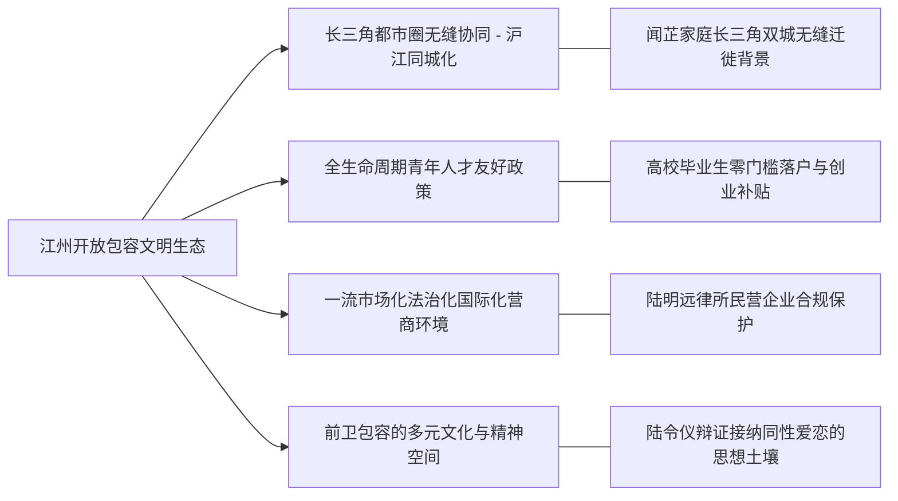

# 虚拟城市·江州市档案：16_开放包容

> **维度定位**：城市格局、文明气度与制度开放性  
> **核心指标**：长三角一体化协同、海纳百川的人才政策、国际化营商环境、多元文化接纳度与制度包容性  
> **叙事关联**：闻芷家庭自沪上迁入江州、陆令仪运用唯物辩证法接纳同性爱恋的包容精神、江州新一代中产青年的思想自洽。

---

## 一、 开放包容：江州的城市精神与文明气象

江州市自古便是水陆通衢、商贾云集的开放之地。在推进中国式现代化进程中，江州秉持“海纳百川、崇文尚德、开明睿智、包容大气”的城市性格，深度融入长三角一体化战略，成为全国最具人才吸附力与思想活跃度的人文新名城。

---

## 二、 核心开放制度与包容实践

### 1. 长三角一体化与“沪江同城”网络
* **人员与生产要素自由流动**：
  * 地铁、城际铁路一码通行，医保、公积金、政务异地跨省互通互认；
* **闻芷家庭的江州选择（典型微观切片）**：
  * 闻芷父亲任职沪上外贸高管，母亲在沿海主理全国性服饰电商品牌，选择将闻芷落户并转学至江州一中，正是看中江州既拥有与上海同频的前沿美学与现代化教育质量，又拥有更宜居的中产生活环境与深厚人文底蕴。

### 2. 人才政策：“留江州，向未来”
* **“零门槛”落户与青年友好**：
  * 大专及以上学历毕业生“先落户后就业”；
  * 为硕博高层次人才提供最高30万～50万元购房补贴、每月1500～3000元租房与生活津贴；
  * 江州高校毕业生留江率突破 **48%**，持续为先进制造业与高新技术产业输入青春血液。

### 3. 一流法治化营商环境（陆明远的执业沃土）
* **“放管服”与民营经济护航**：
  * 深入贯彻落实2025年《民营经济促进法》，坚决破除市场准入壁垒，严禁对民营企业乱罚款、乱检查、乱查封；
  * **陆明远所属律所**长期承办外来投资企业与本地民企的法治审查，确保各类所有制企业在江州享有平等使用生产要素、公开公平公正参与竞争的法治环境。

### 4. 多元精神与前卫思潮的温和接纳（精神层面的终极包容）
* **知识分子家庭的思想开放度**：
  * 江州高知中产阶层不仅严于自律，更具备反思教条、尊重人性的开阔胸襟；
* **同性爱恋的辩证认知与理解（陆令仪的认知跃升）**：
  * 面对闻芷热烈而优雅的同性攻势，陆令仪在深受传统家教约束的同时，并未走向狭隘的道德审判；
  * 借助江州图书馆与当代艺术沙龙提供的丰富人文滋养，陆令仪凭借唯物辩证法跳出传统的单一异性恋偏见，在性观念上接纳同性爱恋的合理性与纯粹性，并在与闻芷的博弈中展现出开阔自洽的心智包容度。

---

## 三、 时代变迁中江州的开放足迹

| 历史时期 | 开放与包容标志性举措 | 城市生机与生活记忆 |
| :--- | :--- | :--- |
| **2018年** | 长三角区域一体化上升为国家战略 | 江州与上海、杭州、南京共建长三角名校高中教学联合体，江州一中与沪上名校教研互动常态化。 |
| **2021年** | 留学生与外来青年人才政策升级 | 江州理工大学设立青年海外高层次人才引育特区，温静姝实验室吸纳大批欧美名校归国青年科学家。 |
| **2023年** | 后疫情时期的跨境商贸复苏 | 举办中国（江州）国际高端模具与新能源供应链博览会，沈振邦团队接待来自欧洲、东南亚的数十国客商，拿下亿级订单。 |
| **2025—2026年** | 《民营经济促进法》率先示范区 | 江州成为全国民营经济活力最充沛、涉企行政争议调解成功率最高的标杆城市，展现出强韧的现代化生机与温和包容的文明品格。 |
